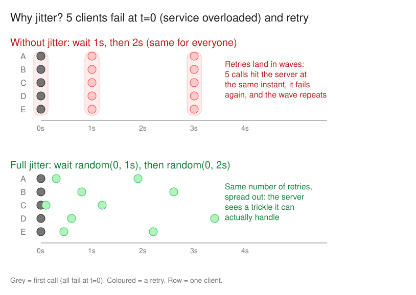
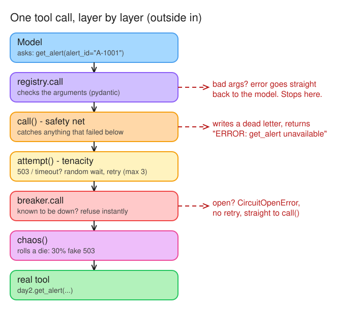
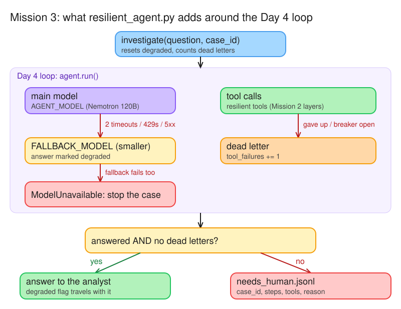

# Day 9 (W02 D06) · Chaos Monkey: tools that fail 30% of the time

> NCP-AAI Phase A · AAI 2.4, 2.5, 9.4 · paired with GH-600 Day 13
> Deliverable: `app/tools_resilience/` with `resilience.py` (retries + jitter + circuit breaker + dead letters), `resilient_agent.py` (fallback model, escalation), chaos results with and without resilience, and an SSE endpoint.

## Big picture: the four properties (same framing as GH-600 Day 13)

| Property | Meaning | Where it lives in my agent |
|---|---|---|
| **Resilient** | Errors and retries are handled | `resilience.py`: retry + jitter, circuit breaker · `resilient_agent.py`: fallback model |
| **Controlled** | No unsafe changes, even on retry | Retry only transient errors · `flag_alert`'s `idempotency_key` (Day 4) makes a retried flag safe · role checks + human approval on side effects (Day 7) |
| **Auditable** | Actions are visible and logged | `dead_letters.jsonl`, `needs_human.jsonl` · audit chain (Day 7) · versioned eval reports (Day 8) · SSE stream of every tool call (Mission 5) |
| **Human-governed** | Escalation ensures oversight | `needs_human.jsonl` when unfinished or any tool failed · Mission 6 failure policy |

## §1 Bets

_Docs closed. Placed before running anything._

**Bet A:** Each tool call fails independently with p = 0.3. With 3 attempts per call, what % of calls still fail after all retries?

- My guess: **10%** (I divided: 0.3 ÷ 3)
- Actual: **2.7%**: a call only fails if attempt 1 **and** 2 **and** 3 all fail, so multiply: 0.3 × 0.3 × 0.3 = 0.027
- Result: **miss**

**Bet B:** Golden tasks solved at 30% tool failure with no retries (the model only sees the error)

- My guess: **4 of 10**
- Actual: **8 of 10** (`chaos_off.md`): the model retried failed tools **itself** (extra steps), and most tasks need 2–3 calls, not 4
- Result: **miss**

**Bet C:** Golden tasks solved at 30% tool failure with retries + breaker

- My guess: **7 of 10**
- Actual: **10 of 10** (`chaos_on.md`)
- Result: **miss**

## §2 Fault taxonomy

### Why jitter (AWS: [Adding Jitter](https://aws.amazon.com/blogs/architecture/exponential-backoff-and-jitter/))

*Editable source: [w02d06-m1-jitter-waves.excalidraw](./img/w02d06-m1-jitter-waves.excalidraw)*

- An overload fails many callers **at the same moment**. Plain backoff brings them all back at the same moment too, which recreates the spike. Backoff spaces the waves out but doesn't break them up.
- **Full jitter:** `sleep = random(0, min(cap, base * 2 ** attempt))`. Each caller picks its own random wait, so the retries arrive as a trickle.
- In our code: `wait_random_exponential(multiplier=0.5, max=8)` waits 0–0.5s after the 1st failure and 0–1.0s after the 2nd (ceiling = `0.5 × 2^(attempt−1)`, from tenacity's source). `stop_after_attempt(3)` ends before the 8s cap matters.
- Check: 50 agents hit by a 429 with no jitter → ~50 retries land together at t=1s, most get 429 again, and the wave repeats at t=3s. ✔
- Caveat: `chaos()` failures are independent coin flips, so jitter won't change today's chaos score. It matters when real load causes the failures (many investigations hitting one sanctions API).

### Fault → response (my picks: 3 right, 2 half right, 3 wrong)

Test for each fault: *would the same request succeed if I just waited?* Yes → retry. No, and the model built the bad input → hand the error back to the model. Failing again and again for everyone → breaker.

| Fault | My pick | Correct | Response |
|---|---|---|---|
| Timeout | Transient ✔ | Transient | Retry with backoff + jitter (only if the call is idempotent) |
| HTTP 429 | Breaker ✘ | **Transient** | Retry after a delay, honouring `Retry-After` if the server sends one. The server is saying "come back later". One 429 isn't an outage; repeated failures will trip the breaker anyway |
| HTTP 503 (once) | Transient ✔ | Transient | Retry with backoff + jitter |
| HTTP 400 | Model's fault ½ | **Permanent** | Don't retry the same request: it fails the same way every time. If the bad field came from the model's arguments, returning the 400 message to the model so it can fix the call is fine (Day 4 path) |
| HTTP 401 | Breaker ✘ | **Permanent** | Don't retry: waiting won't fix a bad or expired credential, and hammering it can lock the account. The service is up; *your key* is the problem. Alert ops |
| `ValidationError` on model args | Permanent ✘ | **Model's fault** | Return the error to the model as the tool result; it corrects the arguments and calls again (Day 4's `registry.call`) |
| Malformed JSON from tool | Permanent ½ | **Model's fault / re-prompt** | Don't crash: give the model an error result so it can try another tool or report partial findings. (A *truncated* response can also be transient) |
| Policy service down 10 min | Breaker ✔ | Sustained outage | Circuit breaker: fail fast during the cool-down, so the agent hears "tool unavailable" at once instead of waiting through retries |

### Dead letters

- A **dead letter** is a call that *exhausted* its retries, hit an open breaker, or failed permanently. Store the tool, args and error so a human or a replay job can pick it up. ✔
- Not every failed attempt: a failure a retry later fixed isn't a dead letter.
- **Never silently drop a failed call that has a side effect** (for example `flag_alert`): if it didn't land, someone has to know.
- In our code: `resilient()` writes `dead_letters.jsonl` **and** appends to `DEAD_LETTERS`, which the agent reads to decide on escalation (Mission 3).

### How the layers stack (`resilience.py`)

*Editable source: [w02d06-m2-resilience-layers.excalidraw](./img/w02d06-m2-resilience-layers.excalidraw)*

- **Lucky call:** chaos passes → real tool → result goes back up. The model never knows anything happened.
- **Unlucky once:** chaos fails → breaker counts 1 → tenacity waits a random moment and tries again → passes. The model still never knows.
- **Unlucky 3 times:** tenacity gives up → `call()` writes a dead letter and hands the model `ERROR: get_alert unavailable`. The model decides what to do next.

### In real frameworks: what's built in vs what stays mine

| Framework | Built in (checked 2026-10-14) |
|---|---|
| **NAT** | `RetryMixin` on configs: `num_retries=5` total attempts, `retry_on_status_codes=[429, 500, 502, 503, 504]` ([source](https://github.com/NVIDIA/NeMo-Agent-Toolkit/blob/develop/packages/nvidia_nat_core/src/nat/data_models/retry_mixin.py)) |
| **LangChain v1** | Middleware: `ModelFallbackMiddleware`, `ToolRetryMiddleware` (exponential backoff), `HumanInTheLoopMiddleware`, `ModelCallLimitMiddleware` / `ToolCallLimitMiddleware` ([reference](https://reference.langchain.com/python/langchain/middleware/)) |
| **LangGraph** | `RetryPolicy` per node (jitter on by default) ([docs](https://docs.langchain.com/oss/python/langgraph/fault-tolerance#retries)) |
| **ADK** | Reflect and Retry plugin: retries failed **tool** calls with guidance to the model, `max_retries=3` per tool ([docs](https://adk.dev/integrations/reflect-and-retry/)) |

**Still mine, whatever the framework:** which errors are transient vs permanent · idempotency keys on side-effect tools · circuit breakers (usually infra: gateway, mesh) · *when* to escalate and *what* the record holds · dead-letter replay · proving it works (chaos test) · not stacking retry layers (framework × SDK, the 6-vs-2 lesson).

## §3 Chaos results

| | Without resilience (`RESILIENT=0`) | With retries + breaker (`RESILIENT=1`) |
|---|---|---|
| **Solved** | **8/10** | **10/10** (bar ≥ 8/10 ✔) |
| Failed | g04 (hit max steps, escalated), g05 (**wrong, not escalated**) | none |
| Extra steps | g08 6 vs 3, g05 6 vs 4: the model retried failed tools itself | — |
| Dead letters | 0 (no resilience layer, so no record) | 1: `search_policy("equal payroll payments")` |
| `needs_human` | g04 (`max_steps`) | g03 (answered, but `tool_failures: 1`) |

- **Why OFF beat the 24% math:** the model saw `ERROR: ... injected 503` and called the tool again. The model is a retry layer too, but an **expensive** one: each of its retries is a full LLM call. Resilience moves retries down to the cheap layer (fewer steps, lower latency and cost).
- **The worst row is g05 OFF: wrong and not escalated.** Without the resilience layer there's no `tool_failures` signal, so a failed case ends silently. The dead-letter count is what makes escalation possible.
- **Caveat:** one run each. Day 8 measured 60–100% run-to-run noise, so the step counts and the silent failure are stronger evidence than 8 vs 10.
- **Is the escalation record enough?** No. An analyst picking up g03 also needs **the agent's draft answer**, **which call failed, with its args** (the dead letter), and **a timestamp** (SLA, audit). Added all three to `investigate()`: `draft_answer`, `dead_letters` (this case's slice of `DEAD_LETTERS`) and `at` (UTC ISO time).

## §4 Fallback & escalation

*Editable source: [w02d06-m3-resilient-agent.excalidraw](./img/w02d06-m3-resilient-agent.excalidraw)*

- **Fallback model:** the LLM is just another remote service. After 2 transient failures (timeout / 429 / 5xx) on the main model, the same request goes to `FALLBACK_MODEL`, and the answer is marked `degraded`. A 400 or 401 doesn't trigger the fallback: a smaller model can't fix a bad request or a bad key.
- **Retry layers multiply:** the OpenAI SDK already retries 2 times by default, so the plan's code hit the main model **6** times before the fallback, and each try could wait the SDK's default **10-minute** timeout. Fix (added): `agent.client = agent.client.with_options(max_retries=0, timeout=60.0)`, so our code is the only retry layer. ([Retries](https://github.com/openai/openai-python#retries), [Timeouts](https://github.com/openai/openai-python#timeouts))
- **One breaker per tool:** isolates failures, so a `search_policy` outage doesn't make `get_alert` fail fast too.
- **Escalation:** `needs_human.jsonl` gets the case when the agent didn't answer **or** any tool call was dead-lettered, even if the answer looks confident (it may have been built without the policy). The record carries case_id, question, steps, tools used, reason, tool_failures and degraded, so an analyst can continue the case.
- **Fallback model chosen:** `FALLBACK_MODEL=nvidia/nemotron-3.5-lightning-30b-a3b` (in the root `.env`): 30B total / **3B active** (MoE) vs the main model's 120B / 12B, and its [model card](https://build.nvidia.com/nvidia/nemotron-3.5-lightning-30b-a3b/modelcard) says it was trained on tool calling for agentic workflows. Smoke test as the main model on A-1002: called `get_alert` → `search_policy`, answered "Yes, EDD (POL-03)" in 3 steps, `stopped: answer`. ✔
- **Limit: shared failure domain.** Both models are served from `integrate.api.nvidia.com`. The fallback covers one overloaded or rate-limited model, **not** a full API outage. In production, put the fallback on separate infrastructure (for example a self-hosted NIM).
- **Retry arithmetic (Bet A reveal):** with p = 0.3 per attempt, 1 attempt fails 30%, 2 fail 9%, 3 fail **2.7%**. A task needing 4 tool calls succeeds 0.973⁴ ≈ **90%** with retries vs 0.7⁴ ≈ **24%** without. This only holds when failures are **independent**. In a real outage all 3 attempts fail together, and that's the breaker's job.
- Verified offline: main model times out twice → `calls: [main, main, small-model]`, `degraded: True`; with no fallback set → `ModelUnavailable`.

## §5 Streaming

- **SSE = one HTTP response that doesn't end**, `text/event-stream`, plain UTF-8 text, one-way (server → client). Each event is `field: value` lines **ended by a blank line** (`\n\n`).
- Fields: `event` (type → `addEventListener(type)`), `data` (payload; consecutive `data:` lines are joined with `\n`), `id` (resume point), `retry` (reconnect ms). A line starting with `:` is a comment: useful as a keep-alive.
- Forget the blank line and the connection stays open, but nothing is delivered: the client keeps buffering one ever-growing event.

- **`sse_app.py`** = the Day 4 loop as a **generator**: each `yield` is one event written to the socket at once, and the loop pauses there until FastAPI asks for the next one. `StreamingResponse(events(), media_type="text/event-stream")`. A list returned at the end would bring the spinner back.
- It imports `resilient_agent`, so the stream gets the same retries, breakers and fallback model.
- **Gap:** it runs its own loop instead of `investigate()`, so streamed cases write **no** `needs_human` record and don't report `degraded`.
- Verified offline (fake model, real tools): events arrive in the order `tool_start → tool_end → answer → done`, as `text/event-stream`.

- **Live run** (A-1002): `tool_start get_alert → tool_end (2 wires) → tool_start search_policy → tool_end (POL-03) → answer → done`, arriving step by step. `obs[:300]` trims the **display** only; the model gets the full tool result.

**Why stream tool events, not just the final text?** An analyst watching a 40-second investigation can:
1. **check the evidence**: which alert and which policy the answer is grounded in;
2. **spot a wrong path early** (wrong alert, wrong policy search) and stop it instead of waiting;
3. **see failures as they happen**: a tool erroring or being retried is visible, not hidden.
It's the *auditable* property, live.

**Interruptibility: the client disconnects mid-run.**
- What stops: the server only advances the generator when it has a client to write to. Once the client is gone, the generator is **never resumed** past its next `yield`, so no further model or tool calls happen. (My guess was "runs to the end": wrong.)
- What doesn't stop: a call **already in flight** (model or tool) runs to completion in its worker thread. The tokens are paid for, and a side-effect tool like `flag_alert` can complete with no `tool_end` ever shown, so the audit log and the idempotency key still matter.
- What's lost: everything. `messages` lives only in the generator's memory, so there's nothing to resume from.
- A proper **Stop button**: check a cancel flag between steps (a clean stop at a step boundary, never mid side-effect), and **checkpoint state after every step** (Day 12's LangGraph checkpointer), so the analyst can resume the same case later instead of starting over.

## §6 Financial-crime angle

**Scenario:** the sanctions-screening tool times out mid-investigation.

- **Action: retry, then halt and escalate.** A timeout is transient, so bounded retries with backoff and jitter come first. If it's still down: **halt the case. No screening result means no release** (fail closed).
- **No fallback here, unlike the model.** A degraded *model* answer is acceptable when it's flagged (Mission 3). A *missing* sanctions check isn't: sanctions screening is a hard control. A cached list could be missing today's designations, and skipping the check is never an option.
- **Who's told:** the case's analyst or owner (`needs_human`), **sanctions compliance** (a hard control didn't run), and **platform on-call** (the service is down for every case, not just this one). **Never the customer**: saying why a payment is held risks tipping off.
- **Escalation record:** case id and **exactly which party or payment wasn't screened** · the failure (error, attempts, timestamps) · **payment status** (held, or was anything released?) · the **last good sanctions-list version** used. The record has to prove the control failed *safely*.

## Reflection

- **Built / measured:** Built a resilience layer (retries with jitter, one circuit breaker per tool, dead letters), a fallback model (nemotron-3.5-lightning-30b-a3b, answers marked degraded) with needs_human escalation records, a chaos test (30% tool failure: 8/10 without resilience vs 10/10 with), and an SSE endpoint streaming tool_start/tool_end/answer live.
- **Surprised / broke:** Retries are geometric (0.3^3 = 2.7%, not 10%). Retry layers multiply: the OpenAI SDK's hidden 2 retries and 10-minute timeout meant 6 calls before the fallback (fixed with max_retries=0, timeout=60). The model retries failed tools by itself, so OFF scored 8/10 at the cost of extra LLM steps. Without the resilience layer, g05 failed silently: no dead letters, so no escalation.
- **On real cases:** Fail closed on hard controls (sanctions screening: no result, no release, no fallback); circuit breakers in infrastructure (gateway/mesh), shared across agent instances; the fallback model on separate infrastructure (same endpoint = shared failure domain); escalation records and dead letters kept as audit evidence, with draft answer, failed calls, timestamps and payment status.
