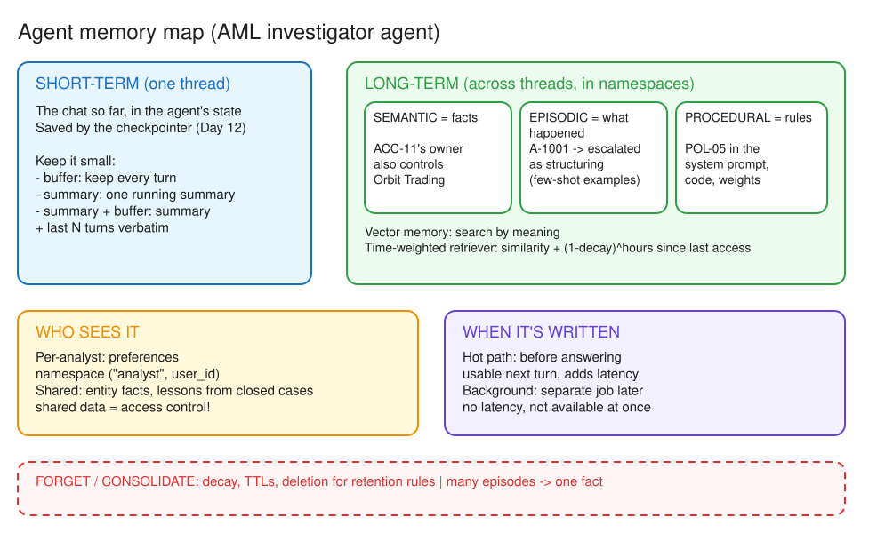
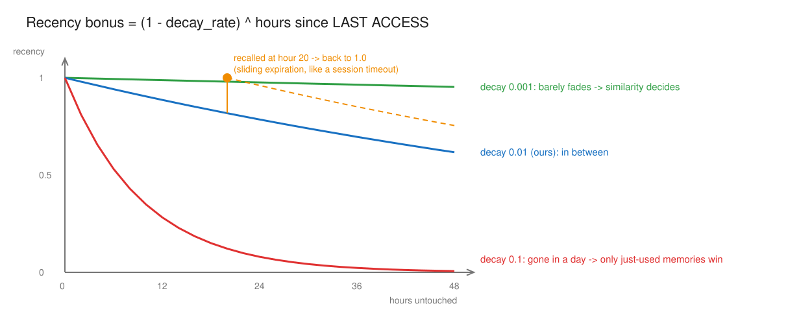

# Day 11 (W03 D01) · Total Recall: what an agent should remember, and for how long

> NCP-AAI Phase A · AAI 1.4, 5.1, 6.1 · paired with GH-600 Day 15
> Deliverable: `app/memory/` with `memory.py` (episodic + semantic long-term memory, time-weighted recall) seeded in Postgres, and `chat.py` comparing buffer vs summary + buffer short-term memory.

## §1 Bets

_Docs closed. Placed before reading anything._

| Bet | Question | My guess | Actual | Result |
|---|---|---|---|---|
| A | Recency left after 100 untouched hours at decay 0.01/h | 0 (fully gone) | **0.366** | miss |
| B | Buffer vs summary + buffer context size on turn 6 | about the same | **about the same**: 1,732 vs 1,937 chars (buffer 0.89×) | win |

## §2 Memory map

*Editable source: [w03d01-m1-memory-map.excalidraw](./img/w03d01-m1-memory-map.excalidraw)*

- **Short-term** = one thread, part of the agent's state, saved by the checkpointer. **Buffer / summary / summary + buffer** manage it so long chats don't overflow the context window.
- **Long-term** = across threads, stored in namespaces. **Semantic** = facts ("ACC-11's owner also controls Orbit Trading"). **Episodic** = experiences ("A-1001 → escalated as structuring under POL-01"), often reused as few-shot examples. **Procedural** = rules (POL-05 "human approves every SAR" in the system prompt, code, weights).
- **Vector memory** and the **time-weighted retriever** are **long-term**: search stored memories by meaning, plus a recency bonus so unused memories fade. _(I first put the retriever under short-term: see gap log.)_
- **Per-analyst** (namespace by user id): an analyst's preferences. **Shared**: entity facts and lessons from closed cases. Shared memory is shared data, so it needs access control.
- **Hot path** when the next turn needs it ("remember ACC-11 is linked to Orbit" → asked about Orbit next turn); **background** when it can wait (no added latency).
- **Consolidation**: many episodes → one fact. **Forgetting**: decay, TTLs, deletion for retention rules.

## §3 Store design

| Namespace | What goes in | Written | Why |
|---|---|---|---|
| `("investigator", "semantic")` | Facts about entities ("ACC-11's owner also controls Orbit Trading") | **Hot path** | The next turn may ask about it, so it must exist before the answer |
| `("investigator", "episodic")` | alert → route → outcome, when a case closes | **Background** | Nothing in the current chat needs it; no latency for the analyst |
| `("investigator", "lessons")` | Lessons distilled from many closed cases (Day 16 Reflexion) | **Background** | Needs many episodes to consolidate; slow LLM work |

- **Setup:** Supabase free tier (session pooler, port 5432, `sslmode=require`), no Docker. `MEMORY_DB` lives in the root `.env`; a `#` in the password had to be percent-encoded.
- **pgvector limit:** HNSW indexes `vector` up to **2,000 dims**; `nemotron-3-embed-1b` returns more, so `setup()` failed. Fix: `"ann_index_config": {"vector_type": "halfvec"}` (16-bit floats, up to 4,000 dims, half the storage). The failed run had already created `store_vectors`, so I dropped the tables and re-ran `setup()`.
- **First recall** for *"structuring case closed after review"*: `A-0902`, `A-1001`, `A-1003`. The week-old `A-0901` (same wording as A-0902) fell out: its recency 0.99^168 ≈ 0.18 vs 1.0 for fresh memories, a 0.82 gap bigger than the similarity gap to the unrelated payroll episode A-1003.

## §4 Time-weighted recall

*Editable source: [w03d01-m3-decay-curves.excalidraw](./img/w03d01-m3-decay-curves.excalidraw)*

- `score = similarity + (1 − decay_rate) ^ hours since last access`. Both terms are 0–1, so a stale memory can lose a full point.
- The clock counts from **last access**, not creation: a recall resets it to 1.0 (sliding expiration), so memories in use stay fresh.
- Low decay → plain similarity search; high decay → whatever was just used wins. At 0.001 the week-old exact match A-0901 would beat the fresh but unrelated A-1003 (0.999^168 ≈ 0.85).
- **Bet A:** 0.99^100 ≈ e^(−1.005) ≈ **0.366**, not 0: multiplying by 0.99 never reaches zero, it only approaches it.
- **Half-life** at 0.01/h: ln 0.5 / ln 0.99 ≈ **69 h (~3 days)**. At 0.001/h ≈ **29 days**. Pick the rate from how fast an investigation goes stale.

- **Decay rate:** 0.01/h, half-life ~69 h. **Ranking before/after the reset:** Mission 2 run `A-0902, A-1001, A-1003` (A-0901 out) → after one similarity-only recall of A-0901 (`MEMORY_DECAY=0`): `A-0901, A-0902, A-1001`. One recall reset its clock and brought it back; both runs after the reset print the same list because all three are now fresh.
- **Retention (financial crime):** everything that names the customer must be deletable: **semantic facts** about them (the most direct personal data), **episodic** case records, and **lessons** that quote case details (or write lessons anonymized). Analyst preferences hold no customer data.
- **Finding them all:** not semantic search (it returns a ranked top-k by meaning, so it misses aliases, account ids like ACC-11 and linked parties, and can't prove completeness). Tag every memory with `customer_id` when it's written, then delete by exact match: `store.search(ns, filter={"customer_id": cid})` → `store.delete(ns, key)` for each, across every namespace. Decay never deletes anything: it only ranks.

## §5 Short-term compaction

| Turn | 1 | 2 | 3 | 4 | 5 | 6 |
|---|---|---|---|---|---|---|
| buffer (chars) | 0 | 374 | 730 | 1,159 | 1,293 | **1,732** |
| summary + buffer (chars) | 0 | 275 | 720 | 978 | 1,092 | **1,937** |

- **Growth:** about the same at 6 turns, and summary + buffer was even *bigger*. Answers are capped at 400 chars, so the buffer grows only ~400/turn, while the 3-line summary costs about as much as the 2 old pairs it replaces. The summary stays roughly flat and the buffer grows linearly, so summary + buffer only wins on long chats (and costs one extra LLM call per turn).
- **Turn 6** ("total in the first alert, and its policy?", correct: 28,500 under POL-01): the summary run got **both wrong / no answer**. Once the summary blurred that "the first alert" = A-1001, the agent couldn't even re-fetch it with its tools. Summaries lose detail **silently**.
- **What a regulator would miss:** exact wording of questions and answers, exact amounts / ids / dates, turn order and timestamps, and **which tool call produced each fact** (provenance).
- **Where the full transcript lives:** an **append-only audit log outside the prompt** (checkpointer thread history + Day 7 audit chain), retained per policy. The summary only feeds the model; it is never the record. Not the vector store: that's ranked, fuzzy recall by meaning with decay, not a complete ordered record.
