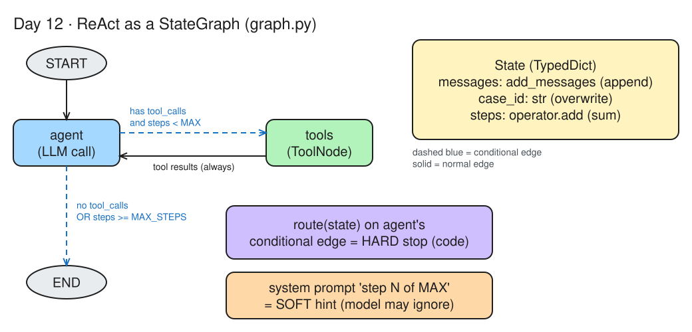
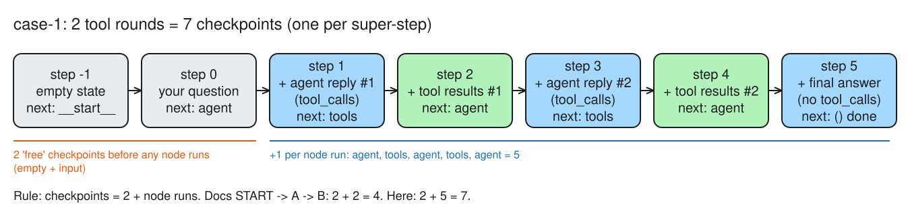
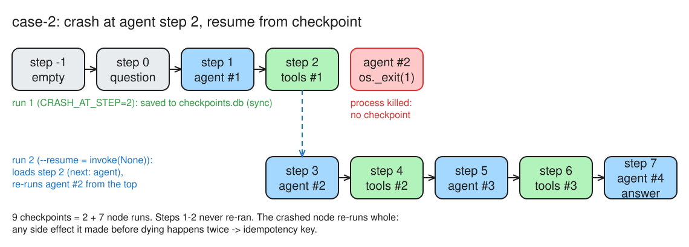
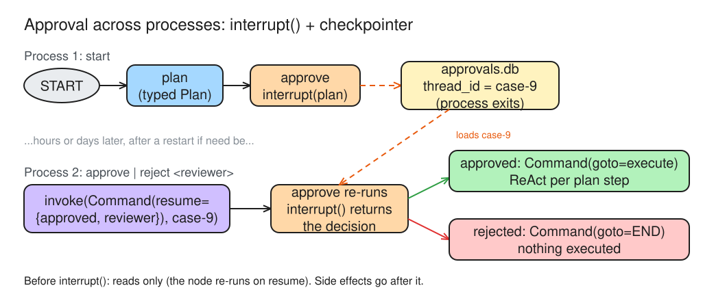

# Day 12 (W03 D02) · Save points: kill the agent, resume it, make it wait for you

> NCP-AAI Phase A · AAI 5.4, 1.6, 5.3, 10.3, 10.4 · paired with GH-600 Day 16
> Deliverable: `app/langgraph/` with `graph.py` (ReAct as a `StateGraph` with a SQLite checkpointer), a crash-and-resume log, and `approval_graph.py` (plan → `interrupt()` → execute) approved from a second process.

## §1 Bet

_Docs closed. Placed before reading anything._

| Bet | Question | My guess | Actual | Result |
|---|---|---|---|---|
| A | A run with 2 tool rounds (agent → tools → agent → tools → agent): how many checkpoints? | 5 | **7** | miss |

## §2 State design


*Editable source: [w03d02-m1-state-graph.excalidraw](./img/w03d02-m1-state-graph.excalidraw)*

- **`messages`**: `add_messages`. It appends new messages and replaces a message whose id already exists. With no reducer, each node's update would **overwrite** the whole conversation.
- **`case_id`**: no reducer. Overwrite is fine because it's set once from the input.
- **`steps`**: `operator.add`, so each node returns `{"steps": 1}` and the reducer sums them. With no reducer it would stay stuck at **1**, `steps >= MAX_STEPS` would never be true, and the loop would never stop.
- **Graph**: `START → agent`, then a **conditional edge** `agent → tools | END` (`route()` reads the state only), then a normal edge `tools → agent`.
- **The `max_steps` stop lives in `route()`**, on agent's conditional edge: that is the **hard** stop, enforced in code. The system prompt's "step N of MAX" is only a **soft** hint the model can ignore. _(I first said the system prompt: see the gap log.)_
- **Routing rule**: if a node only picks the next node, use a conditional edge. If it updates the state **and** picks the next node, use **`Command`** (for example, `approve` saves `reviewer` and goes to `execute` or `END`). Use one mechanism per node.

## §3 Checkpoints


*Editable source: [w03d02-m3-checkpoint-chain.excalidraw](./img/w03d02-m3-checkpoint-chain.excalidraw)*

- **`thread_id` is the primary key**: every checkpoint is filed under it (`case-1`). With no `thread_id`, nothing is saved and nothing can be resumed.
- A checkpoint is a **`StateSnapshot`**: `values` (the state), `next` (the node to run next; `()` = finished), `metadata.step`, `parent_config` (link to the previous one), `created_at`, `tasks`.
- One checkpoint per **super-step** (one tick of the graph). **Rule: checkpoints = 2 + node runs**: an empty one, then the input, then +1 per node run.
- `case-1` measured (`get_state_history`, newest first): **7** = 2 + 5 node runs (agent, tools, agent, tools, agent), `[steps=3]`.

```text
7
5 ()
4 ('agent',)
3 ('tools',)
2 ('agent',)
1 ('tools',)
0 ('agent',)
-1 ('__start__',)
```

- I bet **5** (one per node run) and forgot the 2 checkpoints saved **before** any node runs: the empty state (`next: __start__`) and the input (`next: agent`). _(See the gap log.)_

## §4 Crash test


*Editable source: [w03d02-m4-crash-resume.excalidraw](./img/w03d02-m4-crash-resume.excalidraw)*

- **Savers**: `InMemorySaver` = RAM, lost on crash (tests only). `SqliteSaver` = local file (today). `PostgresSaver` = production, shared by many workers.
- **Durability**: `"exit"` writes only at the end (a mid-run crash loses the whole run). `"async"` writes while the next step runs (a crash can lose the last step's checkpoint, so a crash at the start of agent step 2 could lose tool round 1). `"sync"` writes before the next step starts (nothing lost, a bit slower). `graph.py` uses `"sync"`.
- **Run 1**: `CRASH_AT_STEP=2` → `os._exit(1)` at the start of agent step 2, `exit code: 1`, no answer. Steps -1 to 2 (empty, question, agent #1, tools #1) were already on disk.
- **Run 2**: `--resume` = `graph.invoke(None, config)`: no new input, load the latest checkpoint (`next: agent`) and continue. I predicted it would start at agent step 2: correct.

```text
9
7 () loop
6 ('agent',) loop
5 ('tools',) loop
4 ('agent',) loop
3 ('tools',) loop
2 ('agent',) loop
1 ('tools',) loop
0 ('agent',) loop
-1 ('__start__',) input
```

- **What re-ran, what didn't**: one straight chain of 9 checkpoints (2 + 7 node runs: agent ×4, tools ×3). Steps 1–2 (agent #1, tools #1) **never re-ran**. Only the node that crashed (agent #2) ran again, **from its first line**, because it never got a checkpoint.
- **Side effects**: if the crashed node had already called `flag_alert(A-1001)`, the resume would flag it **twice**. Fix: Day 4's **idempotency key** (for example `case-2:A-1001:flag`), so the second call is a no-op. Checkpoints make resume safe for *completed* nodes; idempotency makes it safe for the node that died mid-way.

## §5 Approval across processes


*Editable source: [w03d02-m5-approval.excalidraw](./img/w03d02-m5-approval.excalidraw)*

- `interrupt(payload)` pauses the node, the checkpointer saves the state, and `invoke()` returns the payload under `__interrupt__`. Any later process sends `Command(resume=value)` with the **same `thread_id`**. The node **re-runs from its first line**, and `interrupt()` now returns `value`. It needs a **checkpointer** + a **`thread_id`**.
- **Before `interrupt()`: reads only.** A write there (e.g. an audit row "approval requested") happens **twice**: once at the pause and once on resume. Put side effects after it, or make them idempotent.
- The paused case lives in **`approvals.db`** under `thread_id` `case-9`. Each compiled graph has its own checkpointer, and the ReAct executor inside `execute` has none. _(I first said `checkpoints.db`: see the gap log.)_
- **Beats Day 2's `input()` gate**: `input()` blocks a live process, so if it dies, the request dies. Here the paused case is **a row in a database**: the starting process exits, a server restart changes nothing, and the case is still resumable by any process, hours or days later.

**Run log**

| Case | Command | Result |
|---|---|---|
| case-9 | `start "Sum the amounts in alert A-1001 and name the policy that applies"` | `WAITING FOR APPROVAL`: 5-step plan (fetch A-1001 → extract amounts → sum → determine policy → return both) |
| case-9 | `approve rana` (new process) | **28500**, **POL-01** |
| case-10 | `start "Is alert A-1003 suspicious?"` | Plan about IPs, malware signatures, threat-intel feeds: the planner assumed a **cyber** alert, because its prompt has no AML domain or tool list |
| case-10 | `reject rana` | `REJECTED by rana: nothing executed` |

- case-10 shows why the gate matters: a **plausible but wrong-domain** plan was stopped before any tool ran. The fix is to ground the planner prompt in the domain and the available tools.

**GH-600 mapping**

| LangGraph | GH-600 (Copilot coding agent) |
|---|---|
| `interrupt()` | the plan waiting for the `plan-approved` label |
| `Command(resume=...)` | adding the label / approving the PR review |
| `thread_id` | the issue / PR number |
| reject → `END` | "Request changes" / close the PR: nothing merges |

## Reflection

- **Built / measured**: ReAct as a `StateGraph` + `SqliteSaver`; 7 checkpoints for 2 tool rounds; crash + resume with no repeated steps (case-2, 9 checkpoints); approval across processes (case-9 approved → 28500, POL-01; case-10 rejected, nothing executed).
- **Surprised me**: the 2 checkpoints saved before any node runs (Bet A: 5 vs 7); a crashed node re-runs from its first line, so side effects need idempotency keys; each compiled graph has its own checkpointer (`approvals.db`, not `checkpoints.db`).
- **Financial-crime angle**: `PostgresSaver` in production; idempotency keys on every side effect (`flag_alert`, SAR drafts, case updates); checkpoints hold customer PII → retention + access control; the approval gate = maker-checker, with reviewer identity and timestamp recorded on resume.
