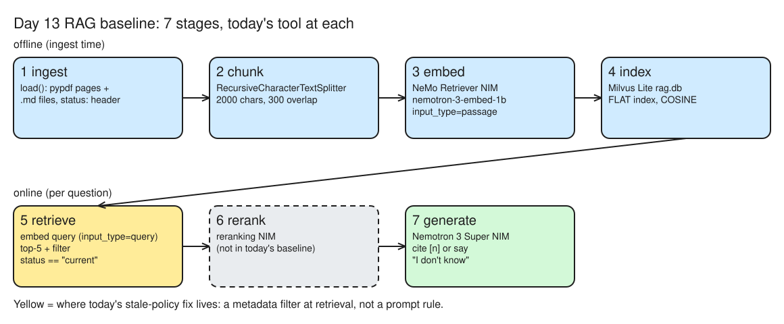
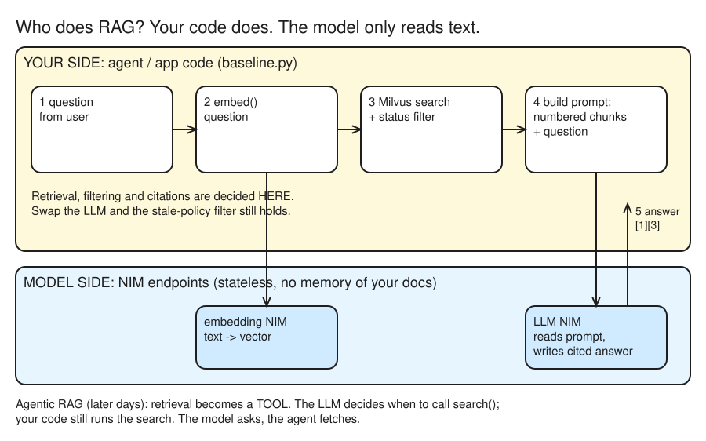
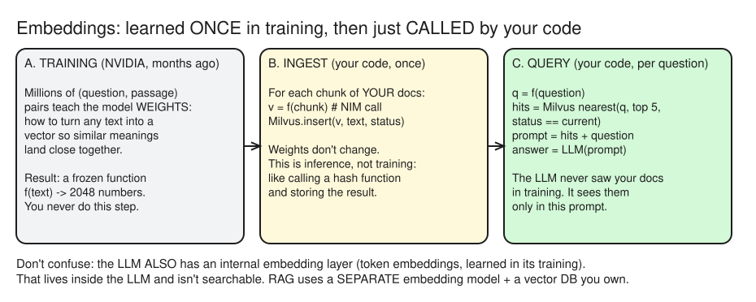
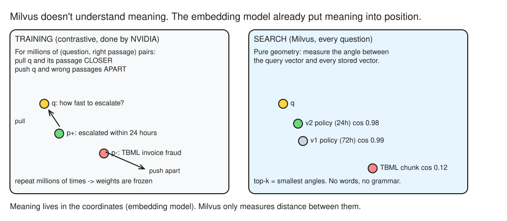

# Day 13 (W03 D03) · Stale context: a RAG baseline that never cites the old policy

> NCP-AAI Phase A · AAI 6.1 · paired with GH-600 Day 17
> Deliverable: `labs/rag/baseline/baseline.py` (NeMo Retriever embeddings + Milvus Lite + a NIM, cited answers and a `status == "current"` filter), a small public + synthetic corpus, and a 20-question eval set.

## §1 Bet

_Docs closed. Placed before reading anything._

| Bet | Question | My guess | Actual | Result |
|---|---|---|---|---|
| A | Asked *how fast must a high-risk alert reach the MLRO?*, does the **unfiltered** baseline cite the superseded 72-hour policy at least once in its top 5? | No | **Yes**: v1 ranked **#2**, right under v2, and the unfiltered answer was **72 hours** | miss |

## §2 Pipeline map

*Editable source: [w03d03-m1-rag-pipeline.excalidraw](./img/w03d03-m1-rag-pipeline.excalidraw)*

- **ingest**: `load()` reads the public PDFs page by page (pypdf) and the synthetic `.md` policies, with each policy's `status:` header kept as metadata.
- **chunk**: `RecursiveCharacterTextSplitter`, 2000 characters (~500 tokens) with 300 overlap. Why split at all: the embedding model has a token limit.
- **embed**: NeMo Retriever embedding NIM `nvidia/nemotron-3-embed-1b`, `input_type="passage"` for documents.
- **index**: Milvus Lite (`rag.db`), COSINE similarity. The milvus.io page says Lite supports only **FLAT** (exact brute force) and Linux/macOS only; the current `milvus-lite` 3.x package (pure Python, FAISS-backed) adds HNSW/IVF indexes and runs on Windows ([PyPI: milvus-lite](https://pypi.org/project/milvus-lite/)). For the exam, know the docs answer: Lite = FLAT, a prototyping store.
- **retrieve**: the question is embedded with `input_type="query"`, top 5 hits, plus an optional `status == "current"` filter.
- **rerank**: the NeMo Retriever reranking NIM re-scores the top hits. It isn't in today's baseline.
- **generate with citations**: the Nemotron 3 Super NIM answers only from the numbered chunks, cites `[n]`, or says *I don't know*.
- NeMo Retriever in the Blueprint: the **embedding + reranking NIMs** sit in the retrieval path; page-elements, table and OCR NIMs handle extraction. Blueprint = NIM microservices + an orchestration layer.

### Who does RAG: agent side or model side?

*Editable source: [w03d03-m3-rag-who-does-what.excalidraw](./img/w03d03-m3-rag-who-does-what.excalidraw)*

- RAG runs on the **agent/application side**. The models are stateless endpoints: the embedding NIM turns text into vectors, the LLM NIM reads one prompt and writes an answer. Neither stores or searches your documents.
- Your code embeds the question, searches Milvus, applies the `status` filter, and pastes the numbered chunks into the prompt. The model only ever "knows" what is in that prompt.
- So freshness and access control are **code guarantees**: swap the LLM and the stale-policy filter still holds.
- **Agentic RAG**: retrieval becomes a tool. The LLM decides *when* and *what* to search; the agent still executes the search.

### Embeddings: training time vs ingest time vs query time

*Editable source: [w03d03-m3-three-times.excalidraw](./img/w03d03-m3-three-times.excalidraw)*

- **Training (NVIDIA, once):** the embedding model learns its *weights*, i.e. how to map any text to a vector so similar meanings land close. Result: a frozen function `f(text) → 2048 numbers`.
- **Ingest (our code, once per corpus):** we *call* `f` on each chunk of our documents and store the vectors in Milvus. Inference, not training: the weights never change.
- **Query (our code, per question):** `f(question)` → nearest chunks → pasted into the LLM prompt. The LLM never saw our docs in training; it sees them only in the prompt.
- Not the same thing as the LLM's internal token embeddings, which live inside the LLM and aren't searchable.

### What Milvus does

- A **vector database**: a collection (≈ table) of rows `id | vector | chunk_id | source | page | status | text`; it answers *"which rows are closest to this vector?"*
- `search()` = scalar filter (`status == "current"`, like a `WHERE`) → score the remaining vectors by the collection's metric (COSINE) → return top-k with `output_fields`.
- v1 and v2 embed to almost the same point (same meaning, different number), so similarity can't separate them: the metadata filter has to.
- **FLAT** = exact, compares against every vector (fine for ~40 chunks). At millions of chunks use an **ANN** index such as **HNSW**: checks a fraction of vectors, tiny recall loss, big speedup.

### How does Milvus "know" two texts mean the same thing? It doesn't.

*Editable source: [w03d03-m3-meaning-is-geometry.excalidraw](./img/w03d03-m3-meaning-is-geometry.excalidraw)*

- The **embedding model** holds the meaning. It was trained **contrastively**: for millions of (question, right passage) pairs, pull their vectors together and push wrong passages apart. After training, *position = meaning*.
- **Milvus** only does geometry: the angle (cosine) between the query vector and stored vectors. It never sees words.
- So retrieval quality is mostly decided by the **embedding model** (and chunking), not the database. That's why `input_type` matters: the model was trained on question→passage pairs.

## §3 RAG vs fine-tuning

- **(a) A new FinCEN advisory the agent must know tomorrow → RAG.** It's knowledge that changes and must be cited: re-index it, don't retrain.
- **(b) Every answer must follow the SAR-narrative layout → fine-tuning** (try strong prompting first). A fixed format is a skill, not a fact. Real systems often need both.

## §4 First answers

_Model: `nvidia/nemotron-3.5-lightning-30b-a3b` (`AGENT_MODEL`). On 2026-10-27 the hosted `nemotron-3-super-120b-a12b` and `nemotron-nano-3-30b-a3b` returned 404 "Function … Not found for account"._

- **Q1** *What cash amount triggers a CTR?* → `USD 10,000`. Retrieval was right (CTR pamphlet p1 is the top hit, our structuring rule #2), but the answer **has no citation** despite the system prompt, is **imprecise** (FinCEN: cash *over* $10,000 in a day, including aggregated transactions), and its "USD 10,000" wording echoes our synthetic policy, not the pamphlet. A generation failure, not a retrieval one.
- **Q2** *The bank's policy on cryptocurrency ATMs?* → "The policy does not mention cryptocurrency ATMs." **Correct abstention**: no invented policy. But retrieval still returned 5 chunks (SAR bulletin, our policies) that have nothing to do with crypto: vector search always returns top-k, however weak the match. Without a similarity threshold, the LLM's abstention is the only guard.
- Takeaway: retrieval and generation fail separately. Citations and abstention are *requested* in the prompt, not enforced, and a model swap (Super → Lightning) changed citation behavior. Check both with an eval set, not by trust.

## §5 Stale vs current

| Run | Retrieved | Answer |
|---|---|---|
| Unfiltered (`ask`) | v2 #1, **v1 (superseded) #2**, 3× FATF | **72 hours** (stale) |
| Filtered (`ask-current`) | v2 #1, 4× FATF | **within 24 hours** |

- **Unfiltered**: both versions reached the prompt and the model **silently picked the stale 72 hours**, with no citation and no hint that two versions existed. Rank #1 didn't make it trust v2.
- **Filter vs "prefer the newest" prompt**: the filter is a **hard guarantee**: v1 never reaches the prompt, so it can't be cited. A prompt rule is a request the model can ignore (it just ignored "cite every claim").
- **GH-600 Day 17 link**: the same *one source of truth* idea on the data side: mark one version `current` and exclude the rest **before** the agent sees them, instead of leaving conflicting copies for the model to sort out.

## Reflection

- **Built / measured:** Built a cited RAG baseline: NeMo Retriever embeddings (nemotron-3-embed-1b, passage/query) + Milvus Lite over 21 chunks (3 public FinCEN/FATF PDFs + 3 synthetic policies) + a NIM that cites [n] or abstains. The status == "current" filter turned the stale 72-hour answer into 24 hours. Froze a 20-row eval set (12 factoid, 5 two-chunk, 3 unanswerable) for Day 26.
- **Surprised / broke:** Hosted Nemotron 3 Super (and Nano 3) returned 404 'Function not found for account', so I switched AGENT_MODEL to nemotron-3.5-lightning-30b-a3b; Lightning then answered without [n] citations despite the system prompt, so citations are a request, not a guarantee, and a model swap can silently change them. Milvus Lite is now pure Python (FAISS): runs natively on Windows with HNSW/IVF, unlike the docs' FLAT-only, Linux/macOS story. Bet A miss: v1 ranked #2 and the model picked 72h with v2 at #1.
- **Financial-crime angle:** On real cases: freshness enforced in code (policy versions carry status/effective dates, filtered at retrieval); access control at retrieval so analysts only retrieve cases they're entitled to; citations enforced and audited (check every claim maps to a retrieved chunk, log retrieved ids per answer); and a similarity threshold so the system abstains in code when nothing relevant comes back.
