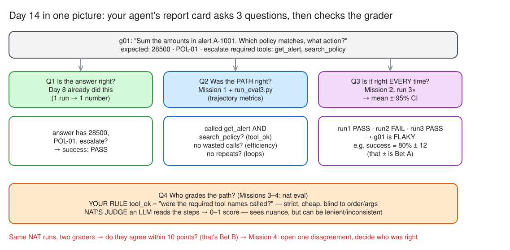
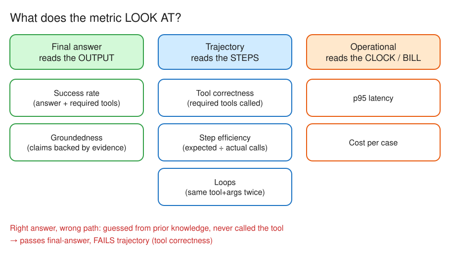

# Day 14 (W03 D04) · Report card: grade the path, not just the answer

> NCP-AAI Phase A · AAI 3.1, 3.2 · paired with GH-600 Day 18
> Deliverable: `app/eval/run_eval3.py` (success, tool correctness, step efficiency, loops; 3 runs → mean ± 95% CI; flaky tasks), plus `nat eval` on the NAT workflow with its runs graded twice: NAT's trajectory judge and your own `tool_ok` scorer.


*Editable source: [w03d04-day-map.excalidraw](./img/w03d04-day-map.excalidraw)*

## §1 Bets

_Docs closed. Placed before reading anything._

| Bet | Question | My guess | Actual | Result |
|---|---|---|---|---|
| A | Run the 10 golden tasks **3 times**. How wide is the 95% CI on the success rate (± points)? | ± 6–15 | **± 18** (86% ± 18; runs 12/14 · 11/14 · 13/14) | miss |
| B | On the **same** NAT runs, does the trajectory judge's average land within 10 points of your deterministic `tool_ok` rate? | Yes | judge **10%**, `tool_ok` **0%** on the same 39 runs, but NAT recorded **no** trajectory (0/39) | **void** |

## §2 Metrics


*Editable source: [w03d04-m1-metric-families.excalidraw](./img/w03d04-m1-metric-families.excalidraw)*

- **Final-answer** (reads the output): success rate, groundedness. _My slip: I first filed groundedness under trajectory and success under operational. Groundedness grades the answer's claims against evidence, not the route._
- **Trajectory** (reads the steps): tool correctness, step efficiency (expected ÷ actual calls), loops (same tool + args twice in a row). NAT's `trajectory` evaluator = a judge LLM reading the intermediate steps + available tools → score 0–1 (1.0 = perfect trajectory); on `429` lower `eval.general.max_concurrency`.
- **Operational** (reads the clock / bill): p95 latency, cost per case.
- **Right answer, failed trajectory:** the agent answers from the model's prior knowledge and never calls the required tool. Final-answer passes, tool correctness fails.

- **Benchmarks (recognise, don't memorise; not named in the official study guide, 3.1 only says "task benchmarks"):** GAIA (multi-step assistant Qs with tools/browsing) · AgentBench (agent across OS/DB/KG/games/web) · τ-bench (tool-agent-user with policies; **pass^k** = succeed on *all* k tries vs pass@k = at least one) · BFCL (function-call accuracy incl. parallel + irrelevant-tool) · SWE-bench (fix real GitHub issues, tests pass) · WebArena (long tasks on self-hosted sites).

## §3 Three runs

Version `df83b328d1af` · 14 golden tasks × 3 runs · report `app/eval/report3-df83b328d1af.json`

```
success     86% ± 18%  (95% CI, 3 runs)   # runs: 12/14 · 11/14 · 13/14
tool_ok     93% ± 0%
efficiency  79% ± 0%
p95 latency 14.2s · loops 0
flaky tasks: ['g09', 'g13']
```

| Task | Runs (success) | Diagnosis |
|---|---|---|
| g05 | ❌ ❌ ❌, `tool_ok` ❌ | **Consistent failure, not flaky**: answers without the required tool (Day 8's guessing bug). Explains `tool_ok` 93% ± 0 |
| g09 | ✅ ❌ ✅ | Flaky answer. Efficiency 0.33 is a **scorer** artefact: it needs 3 × `get_alert`, golden lists the tool once |
| g13 | ❌ ❌ ✅ | Flaky abstain ("SAR deadline not in our policy"); likely **scorer** phrasing (`any_of`) |
| g04 | ✅ ✅ ✅ | Right answer, wasteful path: 5–7 steps (efficiency 0.17–0.25). Only trajectory metrics see it |

- **Day 8 inside the CI?** Yes: Day 8's 80%, 90% and CI's 100% all sit inside 86% ± 18 (≈ 68–100%). Same noise, different samples, not different agents.
- **Why so wide?** 3 runs only 2 tasks apart still give ± 18: t = 4.303 (2 degrees of freedom) × stdev ÷ √3. Before trusting a 5-point gain: **more runs** (t falls toward ~2, √n grows), **more golden tasks** (at 14 tasks one task ≈ 7 points), and **fix the scorer's flaky cases** (g09 expected-call count, g13 abstain phrasing). Temperature 0 would also shrink the bar, but it hides the variance production will see.

## §4 nat eval

`nat eval --config_file config.yml --reps=3` · NAT 1.9.0 · agent + judge = `nemotron-3.5-lightning-30b-a3b` (Super 404s) · 13 items (g10 dropped: `flag_alert` not allowlisted)

```
Workflow Status: INTERRUPTED (workflow_output.json)
Total Runtime: 569.88s
| Evaluator           | Avg Score | Output File                     |
| trajectory_accuracy |       0.1 | trajectory_accuracy_output.json |

tool_ok on NAT's runs: 0% (39 items)   # score_nat_runs.py, same runs
judge average:         10%
```

**The 0.1 measures a broken run, not the agent:**
- **0/39 trajectories captured**: every `intermediate_steps` is empty, so the judge graded blank paths ("The prompt provides an empty agent trajectory…") and `tool_ok` found no `TOOL_END`. The tools *did* run (answers quote 9,500 + 9,400 + 9,600 and "A-1004 not found").
- **18/39 empty answers**: NAT 1.9 `evaluate.py` sets a stop flag on the **first** workflow error; every item not yet started is skipped with `""` → `INTERRUPTED`.
- **10 judge items errored** (7 `SocketTimeoutError`, 2 `OutputParserException`, 1 `ValueError`) → counted as 0.
- **Lesson:** a grader is only as good as its input. Check the eval captured what it claims to grade before trusting any score. Bet B voided.
- `--reps=3` writes one flat `workflow_output.json` with ids `g01_rep0…rep2`; `score_nat_runs.py` strips the `_repN` suffix.

**Setup gotchas (WSL2):**
- NAT isn't supported on native Windows: run in WSL2, `nat` lives only in `hello-workflow/.venv` (Python 3.12 via uv; distro Python 3.14 left alone).
- **Don't `uv add nvidia-nat` at project level:** its `[mcp]` extra resolved `mcp` 1.29.1 and dropped `mcp>=2.0`, `milvus-lite`, `pymilvus` → the Day 5 server (`MCPServer`, 2.x API) failed with `ImportError`. Reverted to the Day 13 lock; NAT keeps its own venv.
- WSL and Windows share `nvidia-labs/.venv` through `/mnt/c`, and each rebuilds the other's; WSL uses `UV_PROJECT_ENVIRONMENT=$HOME/.venvs/nvidia-labs`.

## §5 Who's right

| Run | Answer | Judge | `tool_ok` | Who was right |
|---|---|---|---|---|
| `g09_rep1` "largest amount across A-1001/2/3" | `$120,000` ✅ (golden `120000`) | **0.0**: "entirely unjustified… the model provided a guess" | MISS | **Neither trajectory grader.** 120,000 only comes from `get_alert`, so the tool ran; both graded a broken capture (`intermediate_steps: []`). Only the final-answer check was right |
| `g03_rep2` "can A-1003 be closed?" | `""` (agent's ReAct output failed to parse) | **1.0**, `recovered_from_output_parser_error: true` | MISS | **`tool_ok`.** The judge's parser broke and its recovery path gave a perfect score to an empty answer |

- **Blind spots:** a set-inclusion rule ignores order and arguments and only knows what was captured; an LLM judge can be lenient, inconsistent, or score its own errors as perfect, and it can't tell "no tool call" from "tool call not recorded."
- **CI gate (Day 8): deterministic rules** (final-answer + `tool_ok`): cheap, reproducible, a failure is explainable. **Weekly quality review: the LLM judge**, for nuance (order, arguments, wasted steps), with a human reading its reasoning and spot-checking odd scores (1.0 on an empty answer, 0.0 on a correct one).
- **Always check the capture first**: count non-empty trajectories and answers before reading any average.

## Reflection

- **Built / measured:** Built a 3-run eval + NAT judge: run_eval3.py gave success 86% ± 18% (runs 12/14 · 11/14 · 13/14), tool_ok 93%, efficiency 79%, p95 14.2s, 0 loops; flaky g09 and g13, and g05 fails every run by skipping its tool (a bug, not noise). Then nat eval with a trajectory judge on the NAT workflow, graded twice (judge vs my tool_ok).
- **Surprised / broke:** uv add of NAT at project level broke the deps: nvidia-nat[mcp] pinned mcp to 1.29.1 and dropped mcp>=2.0, milvus-lite and pymilvus, so the Day 5 MCP server (MCPServer, 2.x API) failed with ImportError. Reverted to the Day 13 lock; NAT keeps its own venv in hello-workflow (WSL2 only), and WSL and Windows were fighting over one shared .venv until WSL got UV_PROJECT_ENVIRONMENT.
- **Financial-crime angle:** On real cases: gate on pass^k, not averages (an alert triage agent must be right every time; flaky = fail); the trajectory is audit evidence, since regulators ask how a decision was reached, so a missing trajectory is a compliance gap, not just an eval bug; deterministic rules gate CI, and the LLM judge is used only with an investigator reviewing its reasoning.
