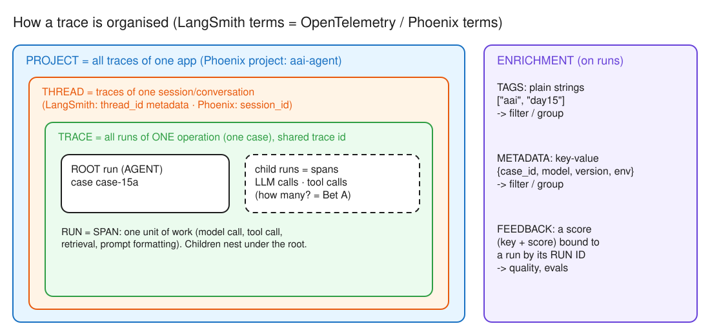
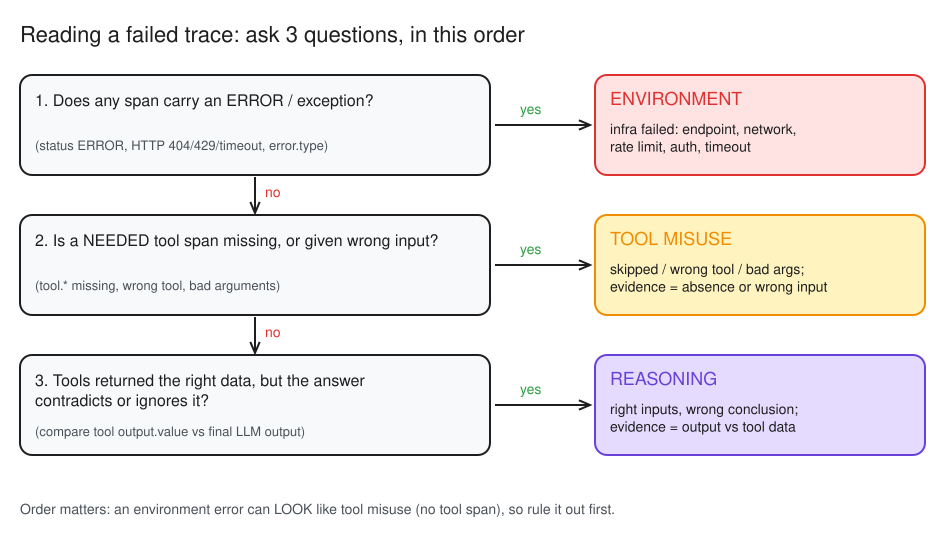

# Day 15 (W03 D05) · Glass box: find the failure in the trace

> NCP-AAI Phase A · AAI 8.2, 3.5, 10.3, 7.3 · paired with GH-600 Day 19
> Deliverable: traces for your own agent and the NAT workflow in Phoenix, plus three deliberate failures (reasoning, tool misuse, environment), each with its class and the span that proves it.

## §1 Bet

_Docs closed. Placed before reading anything._

| Bet | Question | My guess | Actual | Result |
|---|---|---|---|---|
| A | How many spans does one two-tool case produce in your own agent's trace (case root + LLM calls + tool calls)? | 6 (root + 3 LLM + 2 tool) | **6** (root `case case-15a` + 3 `ChatCompletion` + `tool.get_alert` + `tool.search_policy`) | win |

## §2 Tracing model

*Editable source: [w03d05-m1-trace-model.excalidraw](./img/w03d05-m1-trace-model.excalidraw)*

- **Run = span**: one unit of work (model call, tool call, retrieval). **Trace** = all runs of one operation, sharing a trace id (limit 25,000 runs per trace). **Thread** = traces of one session (LangSmith: `thread_id` metadata; Phoenix: `session_id`). **Project** = all traces of one app.
- **Tags** = plain strings to filter/group · **Metadata** = key-value (version, env, case id) · **Feedback** = key + score bound to a run by its **run id**.
- Source: [LangSmith observability concepts](https://docs.langchain.com/langsmith/observability-concepts#how-langsmith-structures-and-visualizes-data)

- **On every trace:** `case_id` (find any case with one filter) and `environment` (dev/staging/prod). _Missed at first, added:_ `model` and **agent/prompt version** (the Day 8 version stamp). Without them, a regression after a model swap or a v2 prompt can't be told apart from a bad case.
- **One case = one trace:** a root `AGENT` span, `LLM` spans for each model call, and a `TOOL` span for each tool call, all nested under the root.
- **Why replay needs more than the user input:** the system prompt may be on a newer version, and the tools (alerts store, policy index) may now return different data. A faithful replay pins the **prompt version** and feeds back the **recorded tool outputs** from the spans.
- **Span count rule:** LLM spans = tool rounds + 1 (the final answer turn). Two tools called one per turn → 3 LLM spans; if the model had called both in **one** turn (parallel tool calls), it would be 2 LLM spans → 5 total.

## §3 Three failures

*Editable source: [w03d05-m3-failure-classes.excalidraw](./img/w03d05-m3-failure-classes.excalidraw)*

- **case-15b (reasoning trap: "A-1003 is payroll, but also structuring") → no failure.** The agent closed it: `tool.get_alert` output (payroll, 3 × 4,200) and the final `ChatCompletion` output agree. The trace proves the answer was *grounded*, not just right. Obvious contradictions get caught; reasoning failures hide in subtle rule misreads (e.g. summing deposits across days against a per-day CTR rule).

- **case-15c (tool misuse: `search_policy` unregistered) → TOOL MISUSE, hidden by a plausible answer.** The trace has `tool.get_alert` but **no `tool.search_policy` span**, yet the final answer still states EDD with a deadline: a policy fact taken from model memory, not from POL-03. Evidence = the *absence* of a span under an answer that cites policy. Fix: fail closed (refuse to state policy requirements unless a `search_policy` span exists in the trace) + a trajectory eval check (Day 14's `tool_ok`).

- **case-15d (environment: `NIM_BASE_URL=.../v2`) → ENVIRONMENT.** The `ChatCompletion` LLM span has status **ERROR** with a 404 `NotFoundError` exception event, and the root `case case-15d` carries the same exception. There are no tool spans, but that's a *consequence*, not tool misuse: question 1 (any ERROR span?) fires first. Fix: config validation at startup (probe the endpoint) + retry/fallback only for transient errors (429/5xx), never for 404.

**The hidden one: case-15c (tool misuse).** 15d failed loudly (exception), 15b passed, but 15c's answer looked *correct*; only the missing `tool.search_policy` span gave it away. Why it's the most dangerous in AML production: it **passes final-answer evals** (CI stays green), carries **stale-policy risk** (when POL-03 changes the agent keeps citing the old deadline from training), leaves an **audit gap** (no retrieval span = no evidence of which policy the decision rested on), and **nobody gets paged** (no error, no exception).

## §4 What I'd monitor

**Code vs config (same visibility, two routes).** NAT: one `general.telemetry.tracing.phoenix` block (`_type: phoenix`, `endpoint`, `project: aai-nat`) + the `nvidia-nat[phoenix]` extra, no code. Compared with my hand-instrumented `aai-agent` trace, NAT's is a **deeper tree** (workflow → ReAct agent → LLM / tool layers), names tools its own way (MCP function group, not `tool.get_alert`), and carries **no business attributes** (no `case_id`, model or tags). **My pick for the bank: both**: config for the framework spans, plus a thin wrapper that stamps `case_id` and agent version on the root, so a regulator's "show me case X" is still one filter.

**Three alerts (Day 19 builds the dashboard):**
1. **Tool-skip rate**: % of answers that cite a policy with no `tool.search_policy` span. Catches the silent class (case-15c); no error ever fires for it.
2. **LLM error rate by type**: spans with status ERROR, split 404 / 429 / 5xx / timeout. Catches environment faults (case-15d); 404 = config, page now; 429/5xx = transient, alert on a sustained rate.
3. **p95 latency per case**: root span duration against the triage SLA.
- Runner-up: **spans per case** (normal ≈ 6 for a two-tool case, per Bet A's rule): a jump means loops or wasted steps.

## Reflection

- **Built / measured:** Hand-instrumented my agent into Phoenix (traced_agent.py, project aai-agent): any case is one filter away by case_id; Bet A won (6 spans = root + 3 LLM + 2 tool; LLM spans = tool rounds + 1). Diagnosed 3 deliberate failures from traces: 15b passed (grounded in get_alert), 15c tool misuse (no search_policy span under a policy answer), 15d environment (404 on the LLM span). Traced the NAT workflow by config alone (aai-nat). Monitoring plan: tool-skip rate, LLM error rate by type, p95 latency per case.
- **Surprised / broke:** 15c looked correct: the right EDD deadline from model memory, and only the missing search_policy span gave it away. 15b didn't fail: the agent caught the obvious contradiction, so reasoning failures hide in subtle rule misreads. Installing NAT into nvidia-labs/.venv on Windows downgraded mcp to 1.29.1 (lock pins 2.3.0) again; fixed with uv sync + its own hello-workflow/.venv-win. NAT's react_agent was 'not found' once, then the same run worked: a flaky plugin load.
- **Financial-crime angle:** On real cases: the trace is audit evidence of how each decision was reached, kept per retention rules; fail closed on policy (no search_policy span means no policy claim, route to an investigator); input/output values hold customer PII, so mask them or keep traces on-prem only; case_id plus model and agent version on every span so a regulator's question about case X is one filter.
