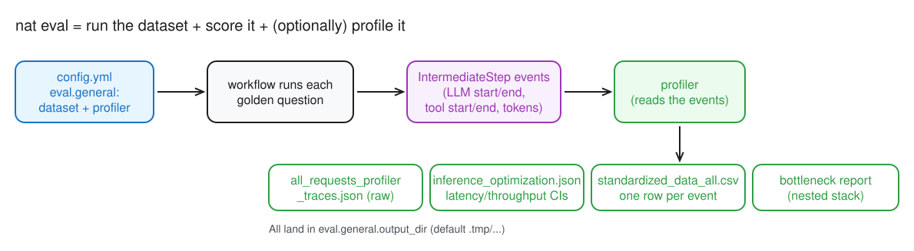
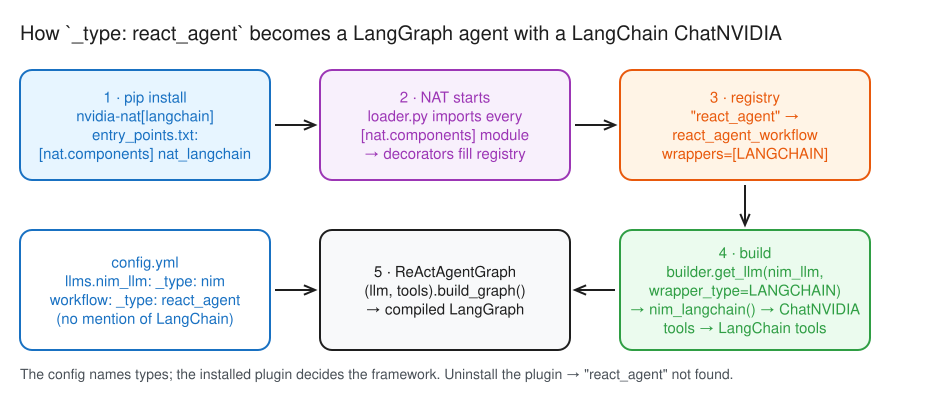
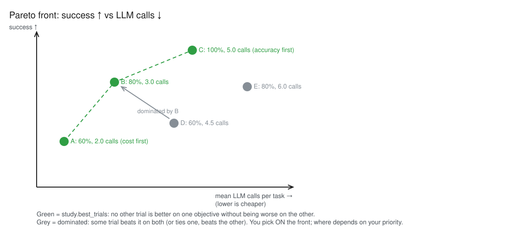
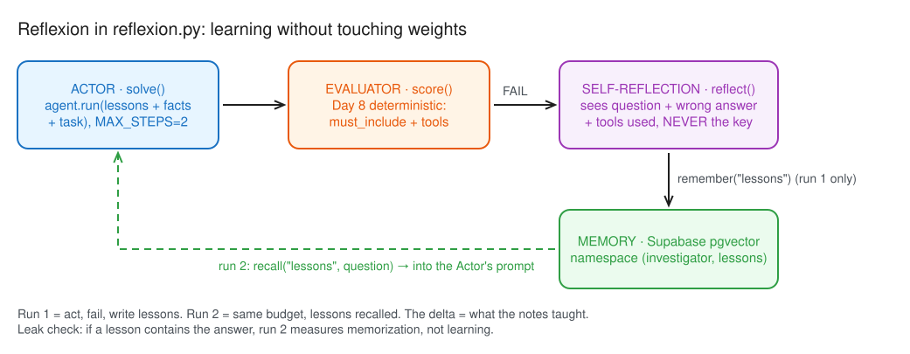

# Day 16 — Tuning loop: profile it, search it, let it learn from failure

> NCP-AAI Week 3 · Day 6 · Objectives: AAI 3.4, 3.5, 2.6, 5.5, 7.3

## §1 Bets

| Bet | Prompt | Guess | Actual | Result |
|---|---|---|---|---|
| A | Where does the NAT workflow spend most of its time? | LLM calls | LLM calls: 98.8% of workflow time (290.7 s of 294.4 s) | win |
| B | Which knob *looks* like it hurts success the most when set badly? | max_steps | max_steps (looks like): 3/6/10 steps → 50/60/80% mean success; one clean pair (trial 3 vs 7) | win |
| C | Of run-1 failures, how many pass in run 2 with lessons? | 2 | 1 (g11 flipped; g07 lost; net 2/14 → 2/14) | miss |

## §2 Profiler

*Editable source: [d16-m1-profiler-pipeline.excalidraw](./img/d16-m1-profiler-pipeline.excalidraw)*

- The profiler runs **through `nat eval`**: a `profiler` block sits next to `dataset` under `eval.general` ([docs](https://docs.nvidia.com/nemo/agent-toolkit/latest/improve-workflows/profiler.html#step-2-configuring-the-profiler-with-eval))
- Options: `compute_llm_metrics`, `workflow_runtime_forecast`, `token_uniqueness_forecast`, `bottleneck_analysis` (`enable_nested_stack`), `concurrency_spike_analysis`, `prompt_caching_prefixes`, `csv_exclude_io_text`
- Outputs (in `output_dir`): `all_requests_profiler_traces.json`, `inference_optimization.json` (latency/throughput CIs), `standardized_data_all.csv`, bottleneck report
- Install: `nvidia-nat[profiler]`
- NAT is the layer around the framework, not the framework itself: `react_agent` is a compiled LangGraph `StateGraph` (agent ⇄ tool loop, built once, invoked per question → one *LangGraph* span each), from the `nvidia-nat[langchain]` plugin. Swap in LlamaIndex/CrewAI/ADK and eval + profiler still work, because events come from NAT's LLM/tool wrappers
- How NAT knew to use LangChain: `nvidia-nat[langchain]` registers a `[nat.components]` entry point → NAT's loader imports it at startup → `@register_function(config_type=ReActAgentWorkflowConfig, framework_wrappers=[LANGCHAIN])` maps `react_agent` to a LangChain builder → `builder.get_llm(..., wrapper_type=LANGCHAIN)` turns `_type: nim` into `ChatNVIDIA`. The config names types; the installed plugin picks the framework

*Editable source: [d16-nat-plugin-resolution.excalidraw](./img/d16-nat-plugin-resolution.excalidraw)*

### Results (`nat eval`, 13 golden questions, `max_concurrency: 2`, 1 rep)

| Measure | Value |
|---|---|
| Workflow runtime | mean 29.4 s · 90% CI [23.8, 35.0] · p90 40.5 s · **p95 43.4 s** (n=10) |
| LLM latency | mean 9.1 s · **p95 27.7 s** (n=32 calls) |
| Time split | **LLM 290.7 s (98.8%)** · NAT overhead ~3.4 s (1.2%) · MCP tools 0.26 s (15 calls) |
| Slowest step | the first LLM call of each run (planning): ~27.6 s, ≈ 60–70% of that run |
| Trajectory accuracy | 0.29, but g08, g09, g13 never ran (0 steps, empty answer → `INTERRUPTED`), so this score isn't a fair quality reading yet |

- Sorted runtimes (s): 10.2, 19.8, 21.1, 21.8, 27.7, 30.4, 38.5, 38.8, 39.9, 46.2. **p95** = the value 95% of runs finish under (interpolated between runs 9 and 10 → 43.4 s); it measures the tail users feel and what SLAs/capacity are sized on. The **90% CI [23.8, 35.0]** is a different thing: uncertainty about the *mean*. With n=10, p95 rests on 2 runs
- Two concurrent runs both finished their first LLM call at the same instant after 27.6 s: looks like queueing at the hosted endpoint rather than generation (hypothesis, unconfirmed)
- Levers I'd pull (my pick): **fewer LLM calls per question** (max_steps, sharper tool descriptions), **fewer reasoning/output tokens** (max_tokens, thinking off), **faster/smaller model or a self-hosted NIM** (no shared queue). Not the tools: 0.26 s total, nothing to win

## §3 Search space

`app/eval/tune.py`: 4 categorical knobs = 2×2×3×2 = **24 combinations**; 8 trials × 5 tasks (g01, g02, g04, g05, g08); objectives **maximise success**, **minimise mean LLM calls**

| Knob | Values | My prediction for a bad setting (before results) |
|---|---|---|
| model | `nemotron-3.5-lightning-30b-a3b` vs `nemotron-3.5-bolt-e4b` (Super 404s on my key) | smaller model → worse tool use: success ↓, maybe calls ↑ |
| system prompt | strict ("get every fact from a tool; never guess") vs loose | not picked as a big mover |
| max_steps | 3 / 6 / 10 | not picked as a big mover (though Bet B says max_steps) |
| tool descriptions | precise vs `"Tool."` | wrong/skipped tools: success ↓, maybe calls ↑ |

- Left out on purpose: sampling (`temperature=1.0`, `top_p=0.95` stay fixed, as the Nemotron model card recommends), prompt caching, model routing

## §4 Pareto front

*Editable source: [d16-m2-pareto-front.excalidraw](./img/d16-m2-pareto-front.excalidraw)*

- One direction per objective: `optuna.create_study(directions=["maximize", "minimize"])`; the objective returns a tuple in the same order ([Optuna tutorial](https://optuna.readthedocs.io/en/stable/tutorial/20_recipes/002_multi_objective.html#run-multi-objective-optimization))
- `study.best_trials` = the non-dominated trials = the Pareto front. There is no single "best" with two objectives; you choose a point on the front by priority
- A trial is **dominated** if another is at least as good on both objectives and strictly better on one
- Plain version: buying a laptop for speed + price. L2 (medium, $800) beats L4 (medium, $1,200), so L4 is out; L1/L2/L3 (cheapest / middle / fastest) are the front. A 100%-success trial at 7 calls is out too: C gets 100% at 5

### Results (`TRIALS=8`, 2026-10-28)

| # | model | prompt | max_steps | descriptions | success | mean calls |
|---|---|---|---|---|---|---|
| **0** | **bolt-e4b** | **loose** | **10** | **vague** | **80%** | **2.6** ← front |
| 1 | lightning | strict | 3 | precise | 40% | 2.6 |
| 2 | bolt-e4b | strict | 3 | vague | 60% | 2.8 |
| 3 | lightning | loose | 6 | vague | 60% | 3.4 |
| 4 | bolt-e4b | strict | 3 | vague | 60% | 2.8 (repeat of #2, identical) |
| 5 | bolt-e4b | strict | 6 | precise | 60% | 3.4 |
| 6 | lightning | loose | 10 | precise | 80% | 3.8 |
| 7 | lightning | loose | 3 | vague | 40% | 2.8 |

- **Front = 1 point (#0)**: it ties or beats every other trial on both objectives, so accuracy-first and cost-first pick the same config today
- Mean success per knob value: max_steps 3/6/10 = 50/60/80% (spread 30) · model bolt 65 / lightning 55 · prompt loose 65 / strict 55 · descriptions 60/60 (no effect)
- Only clean single-knob pair: #3 vs #7 (max_steps 6→3: 60%→40%)
- Surprises: vague descriptions cost nothing here (tool *names* + typed schemas carry the meaning? unverified; Day 4 disagreed); the small Bolt model matched/beat Lightning with fewer calls and ~21 s vs ~36 s per trial
- **Noise check: I'd re-test all four conclusions before trusting them**: #0 as best config, loose prompt is fine, vague descriptions are harmless, Bolt beats Lightning. 1 task = 20 points, every gap is 1–2 tasks, 1 run each at `temperature=1.0`; next time use reps per config (like `reps_per_param_set`) and the full golden set

### `nat optimize` (NAT's built-in version) — [How it Works](https://docs.nvidia.com/nemo/agent-toolkit/latest/improve-workflows/optimizer.html#how-it-works)
- Numeric/categorical params → **Optuna**; prompts → **genetic algorithm** (LLM mutation + recombination over generations)
- `reps_per_param_set`: each config runs N times, scores averaged → stable despite sampling noise
- Several metrics (`eval_metrics`) are scalarized by `multi_objective_combination_mode`: `harmonic` (default, punishes any weak metric), `sum` (compensating), `chebyshev` (worst-case, risk-averse); `pareto_front_2d.png` only with exactly 2 metrics
- Outputs: `best_params.json`, `optimized_config.yml`, plots, `optimized_prompts_gen<N>.json`
- vs my `tune.py`: I keep both objectives and pick from the front; `nat optimize` picks the trade-off for me via the combination mode

## §5 Reflexion

From [Reflexion §3](https://arxiv.org/html/2303.11366#S3):
- Three parts: **Actor** acts, **Evaluator** scores, **Self-Reflection** model turns a failure into verbal feedback stored in memory
- Loop: act → evaluate → reflect → store → retry; **no weight updates** (the "learning" lives in the prompt, via memory)

*Editable source: [d16-m3-reflexion-loop.excalidraw](./img/d16-m3-reflexion-loop.excalidraw)*

### Run 1 (`reflexion.py 1 2`, MAX_STEPS=2, local pgvector store, freshly seeded)

**2/14 PASS** (g07, g14); 12 lessons stored. Most failures hit the 2-step budget (`stopped: max_steps`, answer `None`): tasks needing `get_alert` + `search_policy` + an answer turn can't fit.

**Leak check** (read every lesson against the answer key):
- **g08's lesson says "transactions exceeding $10,000"**; g12's key is `10000` and the scorer strips commas → if g12 recalls it, a run-2 PASS on g12 is suspect (cross-task leak)
- g04's lesson invents a `list_alerts` tool (doesn't exist); g01/g05's push `calculator`, an extra step the budget can't afford → lessons can also *hurt*
- Decision: **kept all 12**, measured as-is; treat a g12 flip as leakage, not learning

### Run 2 (`reflexion.py 2 2`, same budget, lessons recalled; after `docker restart postgres`, all 12 lessons still on disk)

| | run 1 | run 2 |
|---|---|---|
| g11 | FAIL | **PASS** (flipped) |
| g07 | PASS | **FAIL** (lost, no lesson involved) |
| g14 | PASS | PASS |
| other 11 | FAIL | FAIL |
| **total** | **2/14** | **2/14** |

- Lesson that helped (g11): *"first should have used the `get_alert` tool to retrieve the details of alert A-1004"*: a 1-tool task fits the 2-step budget
- Why the rest didn't move: the failures were the budget, but `reflect()` saw only the empty answer + tools used, never *why* the run stopped, so lessons said "use get_alert first" instead of "call both tools in one turn". **The evaluator's feedback must carry the reason**
- g12 didn't flip: the "$10,000" leak didn't materialize
- **Noise (my call): all of it.** g07 flipped the other way with no lesson, so ±1 task at `temperature=1.0` is noise; this run shows no measurable Reflexion effect

| Way to adapt | What changes | Cost | Risk |
|---|---|---|---|
| Reflexion | prompt (verbal lessons) | 1 LLM call per failure, no GPU | lessons can be wrong, invent tools, leak answers |
| Trajectory retrieval | prompt (successful past runs as examples) | cheap; needs successes | only helps on similar tasks |
| RL fine-tuning (NeMo RL: GRPO/DPO) | weights | GPUs, reward/preference data, eval set | durable, generalizes; regressions hard to undo |

- **My pick for the AML agent: Reflexion, with every lesson reviewed by a human before it's stored**: cheap, auditable, and the review catches leaks and invented tools

## §6 Chosen config

- **Carry into Week 4: Lightning · strict prompt · `max_steps=10` · precise descriptions**: change only the one knob with a consistent signal (`max_steps` 3/6/10 → 50/60/80%); strict prompt and precise descriptions cost nothing measurable and are what an auditor wants to see
- **Queued: re-test Bolt** (`nemotron-3.5-bolt-e4b`) with several reps per config on the full golden set: it matched Lightning with fewer calls and ~40% less time, but on 5 tasks × 1 run
- Bigger than Thursday's CI (86% ± 18)? My call: **yes, 30 points > ±18**. Caveat: the ±18 came from 14 tasks × 3 runs; each `max_steps` value here averages 2–4 trials of 5 tasks × 1 run (one task = 20 points), so its own error bar is wider than ±18. Confirm with reps before calling it proven

## Reflection

- **Built / measured:** Profiled NAT (LLM = 98.8% of time, p95 43 s, tools 0.26 s); ran an 8-trial Optuna Pareto study (front = 1 point; only max_steps showed a signal, 50→80%); built Reflexion (run 1 2/14, 12 lessons → run 2 2/14, 1 flip, all noise); chose Lightning·strict·max_steps 10·precise.
- **Surprised / broke:** Reflexion did nothing: the reflector never saw WHY a run failed (the 2-step budget), so its lessons said 'use get_alert first' instead of 'call both tools in one turn'. Vague tool descriptions and the small Bolt model didn't hurt (tool names + typed schemas carry the meaning?). 3 of 13 nat eval questions never ran (INTERRUPTED), still unexplained.
- **Financial-crime angle:** On real cases: lessons need human review before they're stored (leaks, invented tools, PII); tune for recall of escalations first and cost second (the accuracy-first point on the front); profile on-prem with a self-hosted NIM (no shared queue, no customer data to a hosted API); never pick a config on 5 tasks × 1 run: reps + the full golden set as a release gate.
