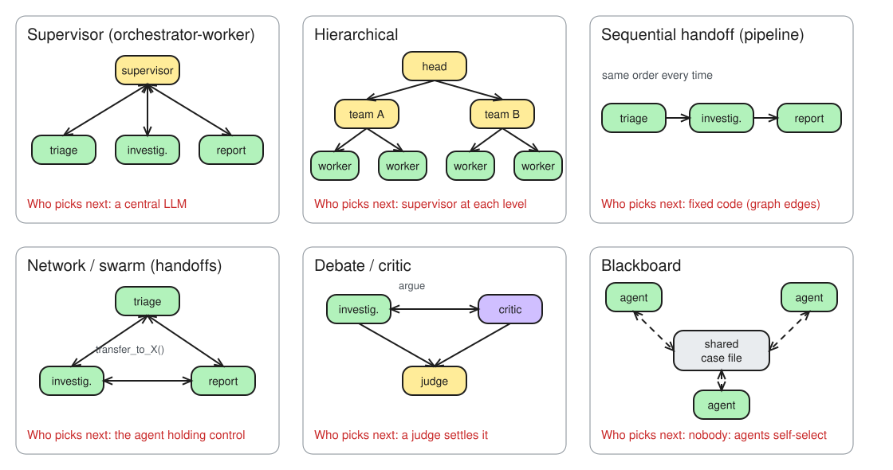

# Day 18 — The squad: a supervisor and three specialists

> NCP-AAI Week 4 · Day 1 · Objectives: AAI 1.5, 1.3

## §1 Bets

| Bet | Prompt | Guess | Actual | Result |
|---|---|---|---|---|
| A | Of the 10 alerts, how many follow the route you expect, first time? | 10 | 6 (DIFF: t03, t06, t08, t10) | miss |
| B | Which worker gets called the **least**? | report_writer | report_writer: 7 (triage 10, investigator 10) | win |

## §2 Patterns

*Editable source: [d18-m1-six-patterns.excalidraw](./img/d18-m1-six-patterns.excalidraw)*

The test for every pattern: **who picks the next agent?**

- **Supervisor / orchestrator-worker**: a central LLM routes each turn to a worker and decides when to finish (LangChain "subagents": workers are called like tools)
- **Hierarchical**: supervisors of supervisors; each level routes within its own team (NVIDIA: higher-level agents supervise lower-level ones)
- **Sequential handoff**: fixed code (graph edges) sends work A → B → C in the same order every time
- **Network / swarm**: the agent holding control picks its successor at runtime via a transfer tool call (LangChain "handoffs")
- **Debate / critic**: peers argue or critique one conclusion and a judge rules; good for high-stakes calls like a SAR recommendation
- **Blackboard**: nobody calls anyone; agents watch a shared workspace and contribute when they can

NVIDIA's orchestration axis: **centralized** (one supervisor: clear control, possible bottleneck) · **decentralized** (agents share info: flexible, needs sophisticated communication) · **federated** (across organizations) · **hierarchical** ([NVIDIA Glossary](https://www.nvidia.com/en-us/glossary/multi-agent-systems/#orchestration))

**Message passing vs shared state.** The workers share one LangGraph state, but in practice they only read `messages`: a short transcript with **one named message per worker turn** (`say()` → `AIMessage(name=...)`). The investigator's inner ReAct tool calls stay inside its own graph; only its final answer comes back. `turns`, `route_log` and `stopped_by` belong to the supervisor. That's why it's blackboard-like state with supervisor control on top.

**Three ways a team fails to stop:**
- **Ping-pong** (triage → investigator → triage → ...): only **`MAX_TURNS`** catches it. `NO_PROGRESS` checks the *last* worker only, and alternating never repeats twice in a row
- **A worker that never says done**: every worker returns `Command(goto="supervisor")`, so control always comes back; the investigator's inner loop is capped by its own `max_steps` (Day 12 `route()`)
- **A supervisor that keeps asking the same worker**: **`NO_PROGRESS`** stops it on the first repeat (the prompt's "never twice in a row" is a soft rule; the guard is the hard one)

## §3 Team design

| Worker | Job | Tools | Done looks like |
|---|---|---|---|
| **triage** | Classify the alert | Reads the alert only (`get_alert`) | Typed verdict: alert found? typology? worth investigating (yes/no + reason) |
| **investigator** | Gather the facts | Day 4 tools: `get_alert`, `search_policy`, sums (Day 12 ReAct graph as a subroutine) | One final answer: facts, total amount, the policy that applies |
| **report_writer** | Draft the case narrative | None | 4 lines: alert, facts, policy, recommended action; only facts already in the transcript |

**Supervisor rules:** triage always first → investigator only if triage says worth investigating → report_writer last (straight after triage for a false positive). **FINISH** when report_writer has written the narrative, or right away if triage found no alert data. Never the same worker twice in a row.

**First run (A-1001, structuring):** `['triage', 'investigator', 'report_writer'] FINISH`. Narrative: three cash deposits ($9,500 + $9,400 + $9,600 = $28,500) just under $10,000 in 7 days → POL-01 structuring red flag. The last line said "escalate to an investigator" even though the investigator had already run: report_writer **echoed the policy wording**, because its prompt never says the team *is* the investigation. Fix idea: give report_writer the team's role (recommend SAR / close / L2 review), not just "use only facts from the transcript".

## §4 Routing results

`uv run python run_alerts.py` → **expected route 6/10** · stops `FINISH` 8, `NO_PROGRESS` 2 · calls: triage 10, investigator 10, report_writer 7. **Every alert stopped.**

| Alert | Expected | Actual | Turns | Stopped by |
|---|---|---|---|---|
| t01 | T > I > R | T > I > R ✅ | 3 | FINISH |
| t02 | T > I > R | T > I > R ✅ | 3 | FINISH |
| t03 | T > R | T > I > R ❌ | 3 | FINISH |
| t04 | T | T ✅ | 1 | FINISH |
| t05 | T > I > R | T > I > R ✅ | 3 | FINISH |
| t06 | T > I > R | T > I ❌ | 2 | NO_PROGRESS |
| t07 | T > I > R | T > I > R ✅ | 3 | FINISH |
| t08 | T | T > I ❌ | 2 | NO_PROGRESS |
| t09 | T > I > R | T > I > R ✅ | 3 | FINISH |
| t10 | T > R | I > T > I > R ❌ | 4 | FINISH |

*T = triage · I = investigator · R = report_writer*

**Who was wrong on each DIFF:**
- **t03**: can't tell from `route_log` alone. Need triage's message: `worth_investigating=true` → the supervisor obeyed (triage/expectation call); `false` → the supervisor ignored it. Log the reasons, not just the route
- **t10**: supervisor wrong. It broke "triage: Always first" → a **soft** prompt rule. Fix in code: `if not log: goto triage` without asking the LLM
- **t06 / t08**: supervisor wrong. On turn 3 it picked **investigator again**, so `NO_PROGRESS` ended the run (t06 got no narrative; t08 should have hit FINISH right after triage said no alert data). Fix in code: `alert_found=false` → END
- **t07** (the judgement call): matched; a new account abroad on payroll was investigated

## §5 Frameworks

> **Which framework would I use?** It depends on the shape: LangGraph for controlled flows, CrewAI for role-based delegation, LlamaIndex when it's mostly retrieval; NAT to instrument all of them.

| Framework | Mental model | Pick it when |
|---|---|---|
| **LangGraph** | State machine: nodes, edges, shared typed state | You need explicit control flow, resumable checkpoints and human-in-the-loop interrupts |
| **CrewAI** | Roles and tasks: a `Crew` runs `Process.sequential` or `Process.hierarchical` (hierarchical needs a `manager_llm` or `manager_agent`) ([docs](https://docs.crewai.com/en/concepts/processes#hierarchical-process)) | You want to describe the team as roles with tasks and let a manager LLM delegate |
| **AutoGen** | Conversations: `RoundRobinGroupChat`, `SelectorGroupChat`, `MagenticOneGroupChat`, `Swarm` ([docs](https://microsoft.github.io/autogen/stable/user-guide/agentchat-user-guide/tutorial/teams.html#teams)) | Know the presets for the exam only: maintenance mode, no new features; new work → **Microsoft Agent Framework** |
| **LlamaIndex** | Data-centric agents over indexes | Agents mostly answer over large indexed document collections |
| **NAT** | Framework-agnostic composition: "Work side-by-side with agentic frameworks to add the instrumentation necessary for observing, profiling, and optimizing your agents" ([README](https://github.com/NVIDIA/NeMo-Agent-Toolkit#key-features)) | You already have agents in several frameworks and need to compose, profile and evaluate them together without rewriting |

## §6 Guards

**Turn cap squeezed (`MAX_TURNS=2`, t01 t03):** both stopped on `MAX_TURNS` after triage > investigator; no report, and the supervisor never got its FINISH turn (the cap is checked *before* the routing call). t03 went to the investigator again, as in the full run: **consistent, not random**, so most likely triage flags it worth investigating every time (a triage/expectation question, not supervisor noise).

**Confusing alert (t11):** two alert ids, 9,500 vs 95,000, unknown account ACC-404 → `triage > investigator > report_writer`, `FINISH`. Never `RECURSION_LIMIT`. But **FINISH ≠ correct**: it only means the supervisor's LLM *chose* to stop. Nothing checks whether the narrative picked the right amount or flagged the conflict. Guards prove **termination**, not **correctness**; correctness needs an eval (Day 8).

| Failure | Caught by | Why |
|---|---|---|
| Ping-pong (investigator ↔ report_writer) | `MAX_TURNS` | `NO_PROGRESS` only compares with the *last* worker; alternating never repeats back to back |
| Supervisor never says FINISH (rotation T > I > R > T…) | `MAX_TURNS` | Same reason: a 3-worker rotation is ping-pong with three players |
| Same worker twice in a row | `NO_PROGRESS` | Stops on the first repeat (t06, t08) |
| Both guards bypassed | `recursion_limit=40` | LangGraph's own last-resort backstop |

**Ends on MAX_TURNS →** keep the case **open**, flagged `unfinished: MAX_TURNS` with the transcript and `route_log`, and send it to the **L1 analyst queue**. Never close it as no action, and never auto-retry until it says FINISH.

**In-process vs protocol:** today the workers share LangGraph state in one Python process. If the investigator were the Sanctions team's service, the call would go over **A2A** (Day 5). To decide to route there, the supervisor reads the agent card's **`skills`** (`screen-counterparty`: description, tags, examples) and top-level **`description`**. `supportedInterfaces` (JSONRPC URL) and `securitySchemes` (OAuth `screening:run`) only matter once it actually makes the call.

## Reflection

- **Built / measured:** Built a LangGraph supervisor team (triage, investigator, report_writer) with typed routing and two guards; 6/10 alerts took the expected route, every alert stopped (FINISH 8, NO_PROGRESS 2), and MAX_TURNS=2 stopped runs early as designed.
- **Surprised / broke:** The supervisor broke its own prompt rules: t10 skipped 'triage first', t06/t08 picked the investigator twice in a row. Prompt rules are soft; the must-hold rules belong in code in supervisor().
- **Financial-crime angle:** On real cases: triage-first and stop-on-no-data enforced in code, every route decision logged with its reason (audit trail), guard stops sent to an L1 analyst queue, and an eval on narratives before anything reaches a SAR.
