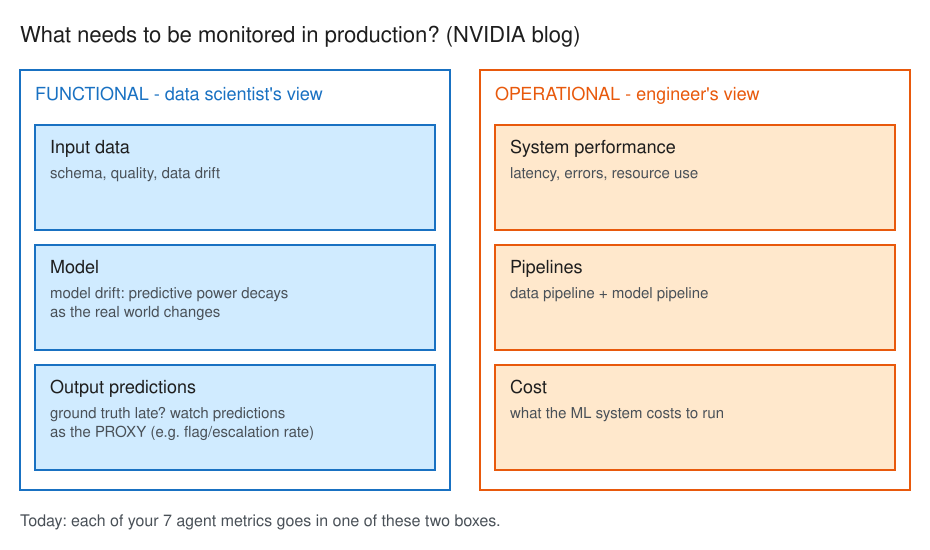
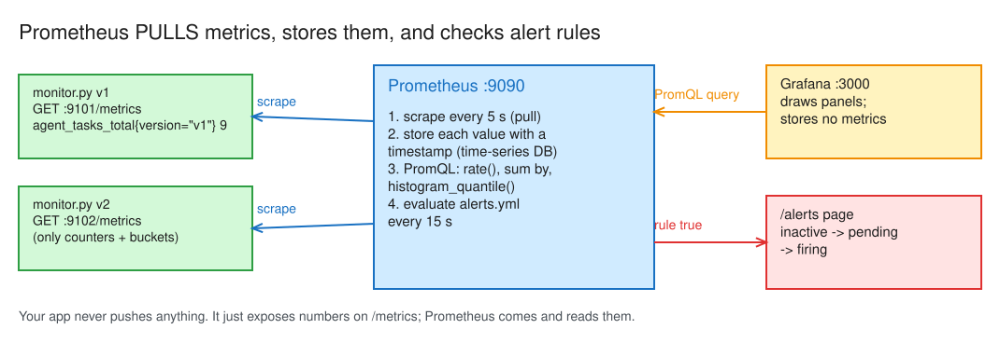
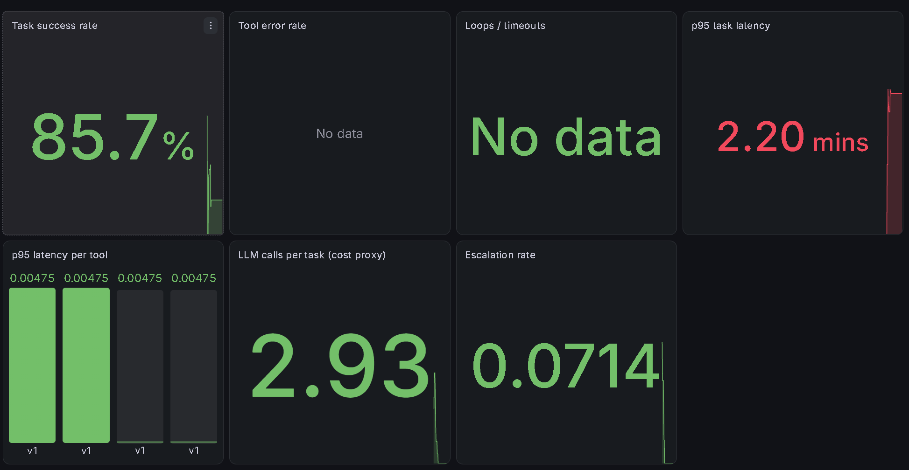
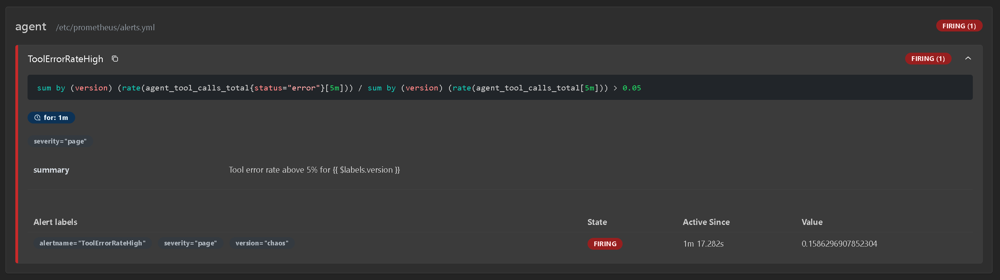
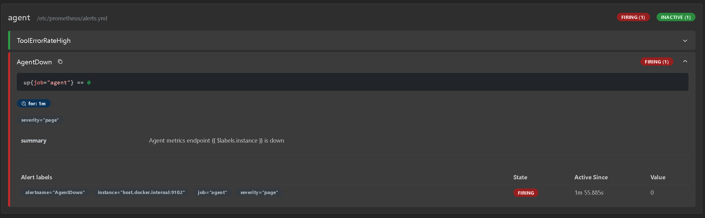

# AAI Day 19 · Control room: a dashboard, an alert, and v1 vs v2

Exam objectives: AAI 8.1, 8.2, 8.3, 8.5 · Paired with GH-600 Day 23

## §1 Bets

| Bet | Prompt | Guess | Actual | Result |
|---|---|---|---|---|
| A | v1's p95 task latency on the golden set (s) | 5–10 s | ~132 s (2.2 min), inside the 80–160 s bucket | miss |
| B | v2 drops "never guess" + "every number from a tool": success vs v1 is… | lower | lower: dashboard 85.7% → 71.4%, gate 86% → 79% | win |

## §2 What to monitor

*Editable source: [w04d02-m1-monitoring-split.excalidraw](./img/w04d02-m1-monitoring-split.excalidraw)*

**From the NVIDIA blog** ([What needs to be monitored in production?](https://developer.nvidia.com/blog/a-guide-to-monitoring-machine-learning-models-in-production/#what_needs_to_be_monitored_in_production)):
- **Functional** = the data scientist's view: input data, the model, output predictions.
- **Operational** = the engineer's view: system performance, pipelines (data + model), cost.
- **Model drift** = predictive power decays as the real world changes. When ground truth arrives late, monitor the **predictions** as a proxy.

**From Prometheus** ([Histograms and summaries → Quantiles](https://prometheus.io/docs/practices/histograms/#quantiles)):
- `histogram_quantile()` estimates a percentile **on the server** from bucket counts. The error is bounded by the width of the bucket the quantile falls in.
- Histograms aggregate across instances (`sum by (le)` then quantile); summaries don't. "Only if aggregation isn't needed, you can start thinking about summaries."

**My seven agent metrics:**

| # | Metric | View |
|---|---|---|
| 1 | Task success rate | functional |
| 2 | Tool error rate | operational |
| 3 | Loops / timeouts (hit `max_steps`) | operational (borderline: the cause is the model not converging, which is functional) |
| 4 | p95 task latency | operational |
| 5 | LLM calls per task (cost proxy) | operational |
| 6 | Escalation rate (`flag_alert`) | functional |
| 7 | **Citation coverage** (my add: share of answers that cite a policy, Day 13) | functional |

Guardrail triggers (Day 21) would also be functional.

**Proxy for late ground truth:** the **escalation rate**. Investigator verdicts take weeks; a sudden change in how often the agent flags is the early warning that something drifted.

## §3 Dashboard

*Editable source: [w04d02-m2-prometheus-pull.excalidraw](./img/w04d02-m2-prometheus-pull.excalidraw)*

- **Prometheus** pulls (scrapes) `/metrics` from each target, stores every sample with a timestamp, answers PromQL, and evaluates alert rules.
- **v1 run:** `df83b328d1af`, 12/14 passed. g05 answered with no tool call (`steps=1`: a tool error would force `steps ≥ 2`); g13 called tools but didn't say "not specified".
- **Grafana** only queries Prometheus with PromQL and draws panels; it stores no metrics.

**v1 dashboard** (golden set, 14 tasks):

| Panel | v1 | Reading |
|---|---|---|
| 1 Success | 85.7% | 12/14 |
| 2 Tool error rate | No data | no `status="error"` series exists yet: 0 errors |
| 3 Loops / timeouts | No data | no task hit `max_steps` |
| 4 p95 latency | 2.20 min | interpolated in the 80–160 s bucket |
| 5 p95 per tool | 4.75 ms each | tools are local Python: all land in the default first bucket (≤ 5 ms), so p95 = 0.95 × 5 ms |
| 6 LLM calls / task | 2.93 | 41 calls / 14 tasks |
| 7 Escalation rate | 7.1% | 1 `flag_alert` in 14 tasks |

**"The agent is slow today" → look at panel 4 (p95 task latency) first:** it confirms the complaint is real and how bad the tail is. Then drill down: panel 6 (more LLM calls per task = more steps), panel 3 (loops hitting `max_steps`), panel 5 (a slow tool). Today the tools take ~5 ms, so slowness means LLM time.

## §4 v1 vs v2

See [d19-v1-vs-v2.md](./d19-v1-vs-v2.md).

## §5 Alert

**From Prometheus** ([Alerting rules → Defining alerting rules](https://prometheus.io/docs/prometheus/latest/configuration/alerting_rules/#defining-alerting-rules)):
- `for` makes Prometheus wait before firing: "Elements that are active, but not firing yet, are in the pending state." A 40 s spike under `for: 1m` goes **pending → inactive** and never pages.
- `keep_firing_for` keeps an alert firing for a while after the condition clears, to stop **flapping** (fire / resolve / fire).
- States: **inactive → pending → firing**.

**It fired** under chaos (`CHAOS_RATE=0.3`, 2 rounds): `version="chaos"`, value **0.159** (15.9% of tool calls failing), active 1m 17s.

- **Why `for: 1m`:** skip blips, page only on a sustained problem. One unlucky timeout shouldn't wake anyone at 3 a.m.
- **Page vs ticket** ([Google SRE: Monitoring Distributed Systems](https://sre.google/sre-book/monitoring-distributed-systems/#tying-these-principles-together): "Every page should be actionable", needs "a sense of urgency"):
  - **Page:** tool error rate > 5% for 1m, `AgentDown`: analysts are getting broken or no answers *right now*.
  - **Ticket / dashboard:** p95 up 30% this week, escalation rate drifting: real, but slow trends nobody can fix at 3 a.m. Paging on them trains people to ignore the pager.

## §6 SLOs and trust

*Lab only today: SLO reading, the SLI panel and the error-budget questions skipped (low exam weight: "Run, Monitor, and Maintain" is 5% of NCP-AAI).*

- **SLI** = a measurement of the service (share of tasks answered); **SLO** = its target over a window (≥ 99% over 28 days); **SLA** = a contract with penalties. **Error budget** = 100% − SLO ([SRE book: SLOs](https://sre.google/sre-book/service-level-objectives/)).
- **Health panel:** `up{job="agent"}`: Prometheus writes `up` for every target on every scrape (1 = scraped, 0 = failed). A dead agent can't report itself, so the scraper does.
- **`AgentDown`** (`up == 0` for 1m, severity page) **fired** for `host.docker.internal:9102` after the chaos agent stopped; `ToolErrorRateHigh` went back to inactive once its series stopped moving.

- **Why `:9102` died: a real outage, not a test.** The chaos run crashed with `openai.RateLimitError: 429 Too Many Requests` from the hosted NIM (three runs hitting the free endpoint at once). `agent.run` doesn't catch LLM errors, so the process exited and `/metrics` went with it. `ToolErrorRateHigh` couldn't see it: it counts **tool** errors, not **LLM** errors. Only `AgentDown` caught it. Gaps: count LLM-call errors as their own metric (`agent_llm_errors_total{code}`), and retry 429s with backoff (Day 9's `tenacity`) instead of crashing.

## Reflection

- **Built / measured:** Built an 8-panel Prometheus + Grafana control room for the agent (success, tool errors, loops, p95, p95 per tool, LLM calls, escalations, health), ran v1 (12/14, 86%) next to v2 (10/14 dashboard, 79% gate), and watched ToolErrorRateHigh (chaos, 15.9%) and AgentDown fire.
- **Surprised / broke:** v1's p95 was 2.2 min, not 5-10 s: task latency is LLM calls x per-call time on a shared hosted endpoint (tools take ~5 ms), and with 14 tasks p95 is set by the 2 slowest, interpolated inside the 80-160 s bucket. Day 14 measured 14.2 s, so today's tail was luck.
- **Financial-crime angle:** On real cases, watch behaviour, not just the pass rate: v2's real regression (g13 stating a 30-day SAR deadline from training data) scored the same FAIL as v1's correct abstention. Flag any number no tool returned, and use the escalation rate as the drift proxy while investigator verdicts are weeks away.
