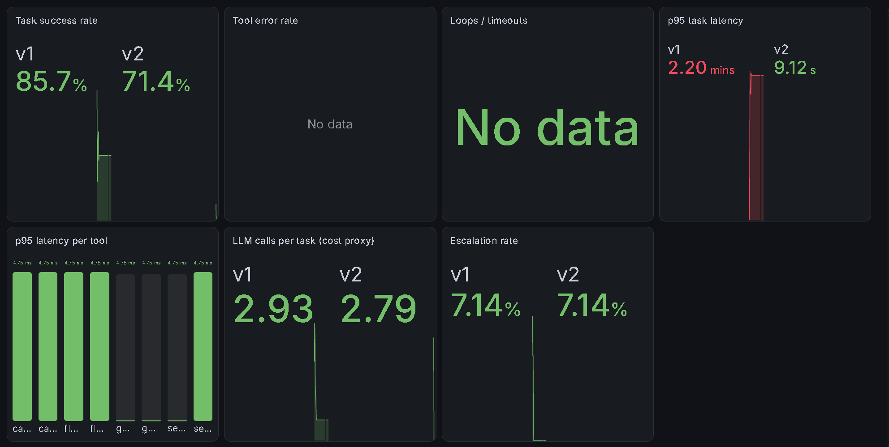

# AAI Day 19 · v1 vs v2

v2 = v1 with the system prompt swapped for `"You are a helpful AML assistant. Answer briefly."`: no "never guess", no "get every number from a tool". Same model, tools and golden set (14 tasks).



## From the dashboard alone

| Metric | v1 `df83b328d1af` | v2 `8f58669fe6ed` |
|---|---|---|
| Task success | 85.7% (12/14) | 71.4% (10/14) |
| p95 task latency | 2.20 min | 9.12 s |
| LLM calls per task | 2.93 | 2.79 |
| Escalation rate | 7.14% | 7.14% |
| Tool errors / loops | none | none |

- v2 broke **g01** and **g09** (PASS → FAIL); g05 and g13 failed in both.
- **Latency gap (2.20 min vs 9.12 s) with the same calls per task and ~5 ms tools:** "Answer briefly" means fewer output tokens per call, and with only 14 tasks, p95 is set by the 2 slowest, so a couple of slow v1 calls on the shared hosted endpoint moved v1's p95 into the 80–160 s bucket. One 14-task run can't separate the two causes; repeated runs (Day 14) can.

## The gate (Day 8 `run_evals.py` + `compare.py`)

```
df83b328d1af 86% -> 8f58669fe6ed 79%
PASS -> FAIL: g01
FAIL -> PASS: none
```

v2 at 79% is under the 80% gate (`MIN_PASS`), so the gate blocks it.

**Reading the failing answers changes the story:**
- **g01 is a scorer artifact, not a regression.** v2 answered `28 500` with narrow no-break spaces (`\u202f`) as thousands separators. `norm()` turns them into normal spaces, so `"28500"` isn't found. The answer (28,500, POL-01, escalate) is right.
- **g13 is the real regression, and the success rate can't see it.** v1 abstained ("the internal policy database doesn't contain a specific number of days"), the right behaviour, but the scorer missed that phrasing. v2 answered **"within 30 calendar days" from FinCEN**, from the model's training data, not a tool: exactly the "never guess" rule v2 dropped. Both score FAIL, so the regression is invisible in the number.
- g09 flipped on the dashboard run but passed in the gate: flaky (Day 14 flagged it).

## Promote v2? **No.**

- **Gap vs noise:** no. Day 14 measured v1 at **86% ± 18** (95% CI, 3 runs ≈ 68–100%); v2's 71–79% sits inside it, so the success rate alone can't prove v2 is worse.
- **The reason is behaviour: v2 guesses.** On g13 it answered a regulatory deadline from training data instead of the policy tool. For an AML agent that's disqualifying whatever the pass rate says.
- **Fixes this exposes:** the scorer should strip all whitespace inside numbers (`\u202f`, `\u00a0`, spaces) before matching, and accept "doesn't contain" style abstentions on g13; add a check that fails any answer stating a number no tool returned.

## Why the version is a hash

Any change to prompt, tool schemas or model gets a new id, so a tool-description tweak or a model swap can't hide under an old name; every dashboard series traces to the exact agent that produced it.
