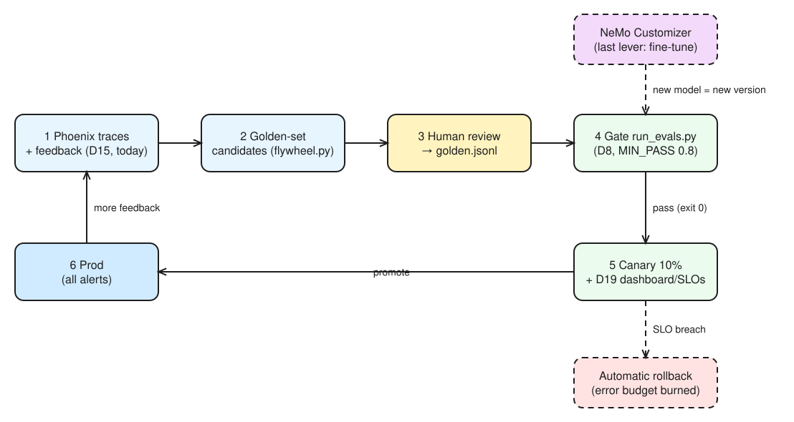
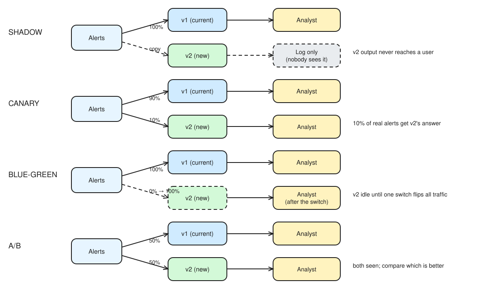

# AAI Day 20 · Flywheel: from a thumbs-down to a release decision

Exam objectives: AAI 8.4 · 8.5 · 3.3 · 5.5 · 10.2

## §1 Bets

| Bet | Prompt | Guess | Actual | Result |
|-----|--------|-------|--------|--------|
| A | 6 feedback rows (2 up, 4 down, 1 on a golden-set question): how many golden-set candidates? | 6 | **3**: 2 thumbs-up filtered (`rating < 0`), g02 exact duplicate skipped; row 5 (same meaning as g02, different words) slipped through | miss |
| B | With approved candidates added, does v2 pass the gate (`MIN_PASS=0.8`)? | Yes | **Yes, 87.5%** (14/16) after fixing the grader; v1 93.8%. Raw run: both 75% (grader misses). v2 ships **with a hallucinated SAR deadline** (g13) | win |

## §2 The flywheel

*Editable source: [w04d03-m1-flywheel-loop.excalidraw](./img/w04d03-m1-flywheel-loop.excalidraw)*

- **Definition** (NVIDIA glossary): "a self-improving loop where data collected from AI interactions or processes is used to continuously refine AI models".
- **NVIDIA's six stages:** data processing (strip **noise and PII**) → model customization → evaluation → guardrails → deployment → refinement from inference logs and human + AI feedback. NeMo map: Curator · Customizer · Evaluator · Guardrails · Retriever.
- **My stack:** Phoenix traces + feedback → golden-set candidates → human review → gate (`run_evals.py`) → canary → prod → more feedback.
- **Where Customizer slots in:** **before the gate**, not after canary (I first said after canary). A fine-tuned model is just a new agent version, so it takes the same gate and canary as a prompt change. NVIDIA's order says the same: customization → **evaluation** → deployment.
- **Why it's the last lever:** cost and time (GPU + days vs minutes for a prompt), it needs lots of curated data (a few thumbs-downs aren't a training set), it often fixes the wrong layer (most failures are prompt / tool / retrieval), and weights are hard to audit or roll back (a prompt diff is readable).
- NVIDIA's Data Flywheel Blueprint repo is deprecated: know the loop, not the repo.

## §3 Feedback design

Built `app/ops/feedback_api.py`: `POST /feedback` stores rating, **reason code**, correction, **trace id** (exact run, Day 15) and **agent version** (prompt + tools + model hash, Day 8). Run: 6 rows on v1 `df83b328d1af`: 2 `good`, 2 `wrong_fact`, 1 `wrong_policy`, 1 `missed_red_flag`; the thumbs-down tagged `good` got a 422 from the handler's own business-rule check (Pydantic accepted every field).

| Reason code | First lever | Owner |
|---|---|---|
| `wrong_fact` (top: 2) | **Retrieval / tools**: did `search_policy` return the right POL, did the agent call it? | Agent eng |
| `wrong_policy` | Prompt + policy corpus (cite the retrieved POL text) | Agent eng + Compliance |
| `missed_red_flag` | **Compliance** defines the red-flag rules; prompt or a check tool enforces them | Compliance + agent eng |
| `unsupported_claim` | Guardrail: answer must cite a source it retrieved | Agent eng |
| `too_slow` | Tuning / serving (Day 16, Day 19 dashboards) | Platform / SRE |

- **Implicit signals** (logged without asking anyone): analyst **overrides the disposition**, **edits the narrative** (edit distance), **reopens** a closed alert, **time to escalate**. They're far more numerous than thumbs, and analysts can't game them.
- **Never store on real cases:** customer names, account / card / SSN-TIN numbers, and **whether a SAR was filed or considered** (SAR confidentiality: disclosure is prohibited, and a feedback DB is read by eng/ML teams). Alert / case ids are internal references and **are** needed: they link feedback to the case under access control. Redact or tokenize before insert (the flywheel's stage 1: strip noise and PII).

## §4 Add / update / retire

*Editable source: [w04d03-m4-release-strategies.excalidraw](./img/w04d03-m4-release-strategies.excalidraw)*

- **Progressive delivery** (Argo Rollouts): roll out in steps, "typically coupling automation and metric analysis to drive the automated promotion or rollback of the update".
- **Add a worker** (e.g. sanctions screening on Monday's team): run it in **shadow** first: it sees real alerts, its output is logged, never used. It gets in when its disposition **agrees with the analysts' final call** on ≥ N% of shadowed alerts **and** it passes the gate.
- **Update a prompt / model:** gate (today) → **canary 10%** of alerts → Day 19 dashboard → promote 25 → 50 → 100%. **Automatic rollback** when the canary burns more than its share of the error budget in the analysis window (its success rate drops below the SLO). Today's lesson: add **must-pass cases** (e.g. SAR facts) and **no regression vs the current version**, because an average pass rate let v2 ship with a hallucinated SAR deadline.
- **Retire a worker:** 1) remove it from **routing** (no new alerts), 2) **drain** in-flight cases (resume from Day 12 checkpoints or hand to a human), 3) **keep the version** (prompt + tools + model hash) and its traces for **audit replay** of past decisions. Never delete its traces or feedback.
- **Who sees the new version?** Shadow: **nobody** (log only) · Canary: a **slice** of real users · Blue-green: **everyone, after the switch** (instant rollback by switching back) · A/B: **both groups** for a fixed split, an experiment to pick the better version, not a safety rollout.

## §5 One feedback, end to end

Row 4: analyst thumbs-down on v1 `df83b328d1af` for A-1001 ("under 10,000, no report needed") → trace **t-4** → reason **`missed_red_flag`** → correction `POL-01; investigator` → `flywheel.py` → candidate **fb-4-A-1001** → human approved (tools `get_alert` + `search_policy`) → golden.jsonl (16 cases) → gate: **PASS** for v1 and v2 → both versions over 80% → v2 may go to canary.

- **Humans:** the **rating + reason** (only an analyst knows a red flag was missed) and **approving the candidate** (corrections can be wrong; near-duplicates like fb-5 slip past exact-match dedup). The **gate run** is automated: it's CI, no judgement in it. The **release** is automated within limits a human set (canary steps, rollback thresholds), and in a bank a model-risk owner signs off the change.
- **fb-4 passed today, but v1 failed it in production:** one pass isn't proof, because LLM output varies per run. The case now guards against the **next** regression; to measure this one, run it several times (Day 14's three runs).

## Reflection

- **Built / measured:** Built the full loop: feedback API (reason codes + trace id + agent version), flywheel job (6 rows -> 3 candidates -> 2 approved, fb-5 rejected as near-duplicate), gate on 16 cases: v1 94%, v2 87.5% after fixing the grader.
- **Surprised / broke:** v2 shipped with a hallucinated SAR deadline (30/60 days, no tool returned it) because an average pass rate can't block one critical failure; exact-match dedup let fb-5 (same meaning as g02) through; the raw gate blocked both versions at 75% because the grader missed right answers (28 500 digit spacing, 'unable to locate', 'do not contain').
- **Financial-crime angle:** Redact PII and SAR status before anything lands in feedback.db; must-pass regulatory cases that block release regardless of score; model-risk sign-off before canary and every version kept for audit replay; an LLM-as-judge grader instead of brittle substring checks.
