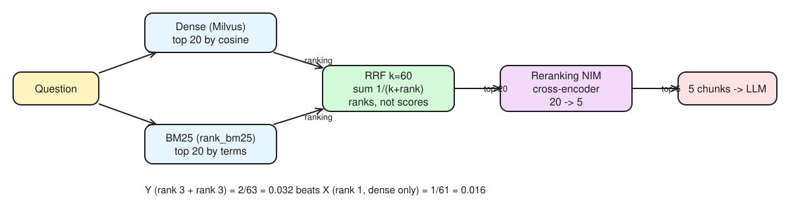

# Day 26 (W04 D07): hybrid search and reranking, measured

Code: [`labs/rag/hybrid/hybrid.py`](../labs/rag/hybrid/hybrid.py) (dense, BM25, RRF, each ± the reranking NIM; plus the HyDE side quest), [`synth_questions.py`](../labs/rag/hybrid/synth_questions.py). Eval set: [`labs/rag/eval-set.jsonl`](../labs/rag/eval-set.jsonl), now **40** questions.



*Editable source: [w04d07-m4-hybrid-rrf.excalidraw](img/w04d07-m4-hybrid-rrf.excalidraw)*

## §1 Fusion & metrics

- **RRF:** score(d) = Σ 1 / (k + rankᵢ) over the retrievers that returned d, k = 60. It uses **ranks only**, because BM25 scores and cosine similarities live on incomparable scales. Worked: X rank 1 dense only → 1/61 ≈ **0.0164**; Y rank 3 in both → 2/63 ≈ **0.0317**: **Y wins**, agreement beats one first place.
- **Reranker (cross-encoder):** scores each (query, chunk) pair with a full forward pass, so cost grows with candidates: retrieve a cheap shortlist (top 20–100), rerank only that. NVIDIA's averages: recall@5 0.570 dense → **0.707** dense + rerank; 0.586 dense + sparse → **0.714** with rerank. Cost: ~1,750 ms to rerank 500 passages on an H100.
- **recall@k:** share of gold chunks in the top k (rank-agnostic). **precision@k:** share of the top k that is gold. **MRR:** 1 / rank of the first gold chunk. **nDCG:** graded, position-discounted gain (rank-aware). With **5 short chunks** in context, **recall@5** matters most (NVIDIA recommends recall for contexts up to ~4K tokens); MRR/nDCG matter when citation order is shown to the investigator or contexts are long (*lost in the middle*).
- Worked example (one gold chunk, returned 3rd of 5): recall@5 = 1.0 · precision@5 = 0.2 · hit@5 = 1 · RR = 0.33.
- **Query rewriting** fixes vague or conversational wording (one extra LLM call). **Multi-query** generates several phrasings and fuses their results: higher recall, N× retrieval cost. **HyDE** embeds a hypothetical *answer* instead of the question, so query and passages live in the same "document" space; costs an LLM call and the fake answer can drift (the dense bottleneck filters most invented details).

### Growing the eval set (objective 6.4: augmentation)

`synth_questions.py` drafts one question per random chunk, so the gold chunk id is known by construction. **q21–q40 are in the eval set**, written from the chunks of the same corpus with the same chunk ids Day 13's splitter produces (2,000 / 300) and every `evidence` string verified to appear verbatim in its gold chunk. They cover the FATF TBML indicator pages and the FinCEN SAR bulletin that q01–q20 barely touched. Caveat (the callout): questions written from one chunk reuse its words, so they flatter the retriever. Spot-check a few and paraphrase the easiest; re-run `uv run python synth_questions.py` if you want the NIM-drafted version for comparison.

## §2 Results

Run:

```bash
cd nvidia-labs/labs/rag/hybrid
uv run python ../baseline/baseline.py ingest   # only if rag.db is missing
uv run python hybrid.py | tee results_run1.md
```

| config | recall@5 | MRR@5 | p50 ms | p95 ms |
|---|---|---|---|---|
| dense | | | | |
| dense + rerank | | | | |
| bm25 | | | | |
| bm25 + rerank | | | | |
| hybrid_rrf | | | | |
| hybrid_rrf + rerank | | | | |
| hyde *(side quest)* | | | | |
| hyde + rerank | | | | |

Questions with no gold chunk (q18–q20, unanswerable) are skipped by the harness, so it scores 37 questions.

## §3 Chosen configuration

Default to ship, pending the numbers: **hybrid RRF (top 20 + 20) → rerank to 5**. Why: BM25 catches exact terms (policy numbers, "CTR", "MLRO") that embeddings blur, dense catches paraphrase, RRF needs no score calibration, and the reranker fixes the order. Cost: one reranking call per query (expect a few hundred ms on 20–40 candidates). Switch to plain hybrid without rerank only if p95 breaks the agent's latency budget and the recall gap is small.

Three misses to classify after the run (wording mismatch, mangled PDF table, or bad gold label):

1. 
2. 
3. 
