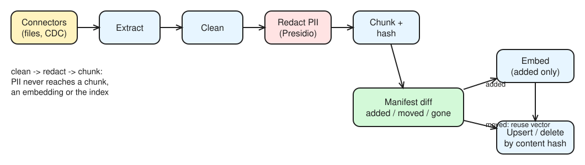

# Day 27 (W05 D01): the ingestion line: clean, redact, dedup, embed, upsert

Code: [`labs/rag/etl/`](../labs/rag/etl/) · `make_inputs.py` (PDFs + policy table + seeded-PII note + planted duplicates), `etl_pipeline.py` (with the `ACCOUNT_ID` recognizer already added), `verify_pii.py`.

> **Not run yet:** the pipeline embeds through the hosted NIM API, which this session couldn't reach. Commands below; §3 and §5 have blanks for the numbers.

## §1 Bets

| Bet | Prompt | Guess | Actual | Result |
|---|---|---|---|---|
| A | Presidio defaults: % of the 14 seeded PII values redacted | _yours_ | `verify_pii.py` before the custom recognizer | |
| B | Edit one paragraph, re-run: what gets re-embedded? | _yours_ | `embedded` in `run3.log` | |
| C | Of the 3 combined questions, how many can Day 13's docs-only baseline answer? | _yours_ | see [d27-rag-structured-kg.md](d27-rag-structured-kg.md) §6 | |

## §2 Ingestion design



*Editable source: [w05d01-m1-etl-line.excalidraw](img/w05d01-m1-etl-line.excalidraw)*

| Stage | Today | At scale (NVIDIA) |
|---|---|---|
| **Connectors** | a local `inputs/` folder | SharePoint, Confluence, S3, databases, each with a change feed |
| **Extract** | `pypdf` text, CSV rows → "key: value" lines | **NeMo Retriever Library** (= NV-Ingest = NeMo Retriever extraction): text, tables, charts, infographics, OCR; `pdfium` or `nemotron_parse`; routes inference through NIMs |
| **Clean** | NFKC, re-join hyphenated words, collapse whitespace | NeMo Curator filters, cuDF on GPU |
| **PII redaction** | Presidio before chunking | NeMo Curator PII modules at corpus scale |
| **Chunk + metadata** | 2,000 / 300 recursive splitter | same, plus layout-aware chunks from extraction |
| **Dedup** | content-hash primary key (exact, per chunk) | NeMo Curator exact + fuzzy (MinHash) + semantic dedup |
| **Embed** | hosted embedding NIM, only new hashes | self-hosted embedding NIM, batched |
| **Upsert** | Milvus Lite upsert by stable primary key | Milvus cluster, bulk insert |

Order matters: **clean → redact → chunk**, so PII never reaches a chunk, an embedding or the index.

Metadata, and why each earns its place:

- **`content_hash` (= primary key):** the same text in two files is one row; re-runs are idempotent (Milvus upsert = insert if new, replace if the key exists).
- **`sources`:** every `file#page` holding that text, so a citation still works after one copy is deleted.
- **`embed_model`:** which model made the vector; vectors from two models are not comparable.
- **`ingested_at`:** freshness, for filters and audits.
- **Manifest:** each file's hash and its chunk hashes, so a run knows what *changed* and what *disappeared*.

**Incremental / CDC:** file hash (what we use; robust, costs a read), `last_modified` (cheap, but touched-not-changed files re-process), or a source system's change feed (SharePoint/Confluence change APIs, database CDC/Debezium): the only one that also reports **deletes** without a full listing.

## §3 Runs

```bash
cd nvidia-labs/labs/rag/etl
uv run python -m spacy download en_core_web_lg   # once: Presidio's NER model
uv run python make_inputs.py
uv run python etl_pipeline.py | tee run1.log      # everything new
uv run python etl_pipeline.py | tee run2.log      # nothing changed
# edit one paragraph of inputs/case_notes_synthetic.md, delete inputs/copy_of_<pdf>, then:
uv run python etl_pipeline.py | tee run3.log
uv run python verify_pii.py
```

| Run | skipped | processed | embedded | relinked | deleted | dups | pii |
|---|---|---|---|---|---|---|---|
| 1: first | | | | | | | |
| 2: no change | | | | | | | |
| 3: edit + delete copy | | | | | | | |

What each line proves:

- **Run 2 is the no-op proof:** every file `skipped` by digest, `embedded = 0`, `deleted = 0`.
- **Run 3 proves the duplicate survives:** deleting `copy_of_<pdf>` gives `relinked > 0` and **no deletes** for that text: the hash is still in the original PDF, so the row stays and only its `sources` shrink (no embedding call). The edited note gives a few `embedded` (only chunks whose text changed) and `deleted` for their old hashes.

## §4 Incremental

The note is one 2,000-char chunk, so editing one paragraph re-embeds **that chunk only** (it's the whole note here; in a long document it would be just the changed chunk plus any chunk the overlap carries the edit into). Unchanged files cost a hash and nothing else.

## §5 PII verification

| | Seeded values redacted (of 14) | Leaked |
|---|---|---|
| Presidio defaults | | expected: both `ACC-…` ids (no built-in recognizer knows the bank's format) |
| + `ACCOUNT_ID` PatternRecognizer | | target **0** |

Presidio recognizer types: `CREDIT_CARD`, `IBAN_CODE` = pattern **+ checksum** (the seeds use valid test numbers, so they pass); `EMAIL_ADDRESS`, `IP_ADDRESS`, `PHONE_NUMBER` = patterns + context; `PERSON` = spaCy NER (watch for misses on unusual names and false positives on capitalized policy words). `verify_pii.py` checks the **index**, not the pipeline's log: if a seed string is in a stored chunk, it leaked.

False positives to watch: NER tagging "MLRO" or a jurisdiction as a PERSON would delete retrieval keywords. Note any you see here.

## §6 Re-embedding & scheduling

- A new embedding model makes every stored vector incompatible: queries embedded by model B can't be searched against vectors from model A. `embed_model` on each chunk tells you exactly which rows are stale.
- Re-embed into a **new collection**, evaluate it against the eval set, then switch the alias (blue/green). Re-embedding in place would leave a half-migrated index serving mixed vectors during the job.
- Scheduling: change-feed or hourly incremental runs for documents; a full rebuild only on model or chunking changes.

## §7 Financial-crime angle

Case notes and SAR narratives are full of PII and SAR-confidential facts. If PII reaches an embedding it can be recovered from the vector store and shows up in any user's retrieval, so redaction must sit **before** chunking and be verified against the index. Internal formats (account ids, case ids, customer numbers) always need custom recognizers. Deleting a source must actually remove its text from the index, or a retention/erasure request isn't honoured.
