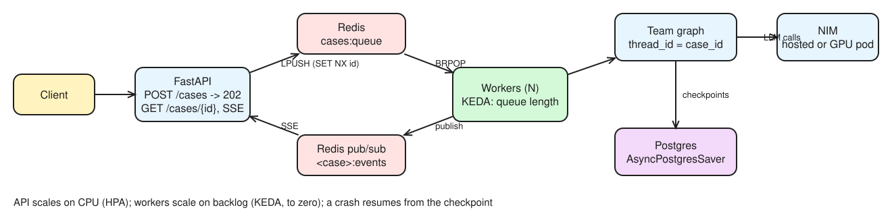

# Day 28 (W05 D02): ship it: a queue-backed investigation service, ready for Kubernetes

Code: [`app/service/`](../app/service/) · `api.py` (enqueue, status, SSE, `/healthz`, `/readyz`), `worker.py` (Day 18's team + `AsyncPostgresSaver`), `Dockerfile`, `compose.yaml`, `k8s/` (API + CPU HPA, worker + KEDA ScaledObject, a GPU NIM), `locustfile.py`.

> **Not run yet:** Docker, kind and the hosted NIM API weren't reachable from this session. Run commands are in each section; blanks are for your numbers.

## §1 Bets

| Bet | Prompt | Guess | Actual | Result |
|---|---|---|---|---|
| A | Pod requesting `nvidia.com/gpu: 1` passes `kubectl apply --dry-run=server` on a GPU-less kind cluster? | _yours_ | **yes** (validation only, no scheduling; on a real apply it sits *Pending: Insufficient nvidia.com/gpu*) | |
| B | p95 of `POST /cases` at 50 users (ms) | _yours_ | `results/lt50_stats.csv` | |
| C | What saturates first at 50 users? | _yours_ | from the load test | |

## §2 Architecture



*Editable source: [w05d02-m1-service.excalidraw](img/w05d02-m1-service.excalidraw)*

Client → `POST /cases` → **202** + `case_id` at once → Redis list `cases:queue` → N workers → the team compiled with `AsyncPostgresSaver`, `thread_id = case_id` → node updates published on `<case_id>:events` → `GET /cases/{id}` and an SSE stream.

- **Why a queue, not the agent inside the HTTP request:** investigations take minutes; clients and load balancers time out long before. The API only enqueues, workers scale on their own, and **queue depth** becomes the scaling signal (KEDA).
- **Why an idempotent task id:** clients and queues retry. `SET case_id NX` means the same alert submitted twice returns the existing case instead of a duplicate investigation (and a duplicate SAR draft).
- **Postgres checkpointer + `thread_id = case_id`:** a worker that dies mid-case leaves its checkpoints; another resumes from the last one. `InMemorySaver` is for experiments; `PostgresSaver` / `AsyncPostgresSaver` is the production one (async graph → async saver).
- **Known gap:** `BRPOP` removes the job before the work is done, so a dying worker loses it. At-least-once: `BLMOVE` into a per-worker *processing* list, delete when finished, a reaper re-queues stale entries; the checkpoint lets the retry resume.

```bash
cd nvidia-labs/app/service
docker compose up -d --build
curl -s -X POST localhost:8000/cases -H 'Content-Type: application/json' -d '{"alert_id":"A-1001","alert_text":"Alert A-1001: three cash deposits in 7 days."}'
curl -s -X POST localhost:8000/cases -H 'Content-Type: application/json' -d '{"alert_id":"A-1001","alert_text":"Alert A-1001: three cash deposits in 7 days."}'   # same case_id back
```

## §3 GPU stack

- **GPU Operator** automates what a GPU node needs: **driver**, **Container Toolkit** (containers can use the GPU), **device plugin** (advertises `nvidia.com/gpu` to the kubelet: this is what makes it schedulable), **GFD** (labels: GPU model, memory, MIG capability), **DCGM Exporter** (metrics to Prometheus). GPUs are whole, non-overcommittable resources unless sharing is configured.
- **MIG:** hardware partitions with isolated memory and faults (A100/H100) → **two tenants' fraud models on one H100**. **Time-slicing:** shares a GPU without isolation, works on GPUs without MIG → **dev notebooks on an L4** (no MIG on L4).
- **NIM Operator:** `NIMCache` pre-downloads models to shared storage; `NIMService` is one NIM (can create an HPA, ingress, ServiceMonitor; scales on DCGM or NIM metrics); `NIMPipeline` groups services.
- **NIM Helm chart values:** `image.repository/tag`, `model.ngcAPISecret` + `imagePullSecrets`, `persistence` (model cache), `resources` (GPU limits), `customArgs` (engine flags), `env`; Deployment mode with `strategy: Recreate` when there's no spare GPU for a rolling update.
- **Side quest (Triton + TRT-LLM autoscaling blog):** needs NFD, device plugin, GFD, DCGM Exporter + Prometheus; GPUs per pod = **TP × PP**; ports 8000/8001/8002; a PodMonitor scrapes 8002; HPA on custom metric `triton:queue_compute:ratio` (queue time ÷ compute time) targeting 1000m, scaled 1 → 4 → 1. **Why the ratio beats GPU utilization:** a GPU can read 100% busy while requests are fine, or be "busy" doing small batches; queue÷compute says directly whether requests wait longer than they compute, i.e. whether users feel it.

## §4 Kubernetes

```bash
kind create cluster --name capstone
helm repo add kedacore https://kedacore.github.io/charts && helm repo update
helm install keda kedacore/keda -n keda --create-namespace --wait
kubectl apply --dry-run=server -f k8s/
```

- **Validates on kind:** schemas, admission, the GPU request (a valid extended resource), and the `ScaledObject` **only because KEDA's CRDs are installed first** (`--dry-run=client` wouldn't notice a missing CRD). Same for a `PodMonitor` before kube-prometheus-stack.
- **A real cluster adds:** GPU Operator (nodes that actually offer `nvidia.com/gpu`), NIM Operator, a PVC for the model cache, Prometheus + Prometheus Adapter (`custom.metrics.k8s.io`) for GPU/NIM-metric HPAs.
- **Why HPA on CPU is wrong for agent workers:** they spend their time waiting on LLM calls, so CPU stays low while the queue explodes. **KEDA's `redis` list trigger** scales on `listLength` per replica (the backlog itself) and can scale to **zero** (`activationListLength`). CPU HPA is fine for the API.
- **KV-cache-aware routing** (NVIDIA Dynamo) sends a request to the worker that already holds the matching prefix's KV cache, skipping a prefill recompute.

## §5 Load test

```bash
mkdir -p results
uvx locust -f locustfile.py --headless -u 10 -r 2 --run-time 2m -H http://localhost:8000 --csv results/lt10
uvx locust -f locustfile.py --headless -u 50 -r 5 --run-time 2m -H http://localhost:8000 --csv results/lt50
docker compose exec redis redis-cli LLEN cases:queue
# RIGHT AWAY: stop spending hosted-API calls on the backlog
docker compose stop worker && docker compose exec redis redis-cli DEL cases:queue
```

| Users | req/s | `POST /cases` p50 / p95 | `GET /cases/{id}` p50 / p95 | failures | queue left |
|---|---|---|---|---|---|
| 10 | | | | | |
| 50 | | | | | |

Where the time goes: enqueue is a Redis `SET NX` + `LPUSH`, so `POST` should stay in single-digit ms; the backlog grows because **workers / the NIM API rate limit** are the bottleneck. Next: **AIPerf** (GenAI-Perf's successor) on the LLM endpoint for TTFT, inter-token latency and tokens/s (Day 30), and **Nsight Systems** only if a self-hosted GPU shows low utilization and you need the kernel timeline. **DGX Cloud Benchmarking**: NVIDIA's recipe-based end-to-end performance measurement on reference platforms (know the name).

## §6 Cost & HA

- **MIG:** split one A100/H100 into isolated slices for small models (triage classifier, embeddings); the L4 has no MIG.
- **Spot + fallback:** workers on spot nodes; when spot capacity disappears, fall back to on-demand or to the hosted NIM API (Day 9's fallback model pattern).
- **Scale-to-zero:** fine for workers; for a self-hosted LLM NIM the model-load cold start (minutes on an empty cache) counts against the latency SLO, so keep ≥ 1 warm replica or a `NIMCache`.
- **Multi-replica:** ≥ 2 API replicas spread across nodes, plus a `PodDisruptionBudget` so a node drain never takes both.

**Halve cost at the same SLO:** right-size the model per agent (a small model for triage and routing, the big one only for the investigator), MIG for the small ones, spot workers with fallback, prefix/KV reuse for the shared system prompts, a response cache for repeated policy look-ups, and batch non-urgent alerts overnight. **Month-end burst of 5,000 alerts:** the API accepts all of them in seconds (202s), the queue absorbs the burst, KEDA scales workers to the max replica count, and the real ceiling is the NIM rate limit / GPU count: the backlog drains at that rate. Prioritize by risk (a separate high-priority list for sanctions hits) so the SLA for urgent alerts holds while the rest wait.
