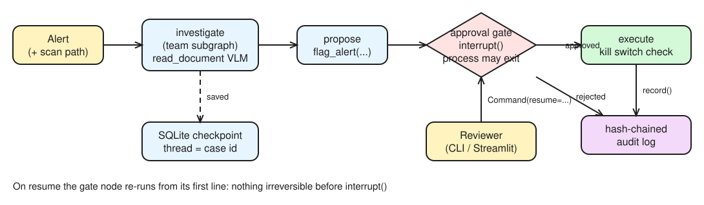

# Day 29 (W05 D03): eyes, a front door and a human

Code: [`app/multimodal/`](../app/multimodal/) (`make_scan.py`, `doc_tool.py`, `make_call.py`), the `read_document` tool in [`app/langgraph/graph.py`](../app/langgraph/graph.py), [`app/workflows/investigation-workflow/config.yml`](../app/workflows/investigation-workflow/config.yml) (team under NAT), [`app/team/approval.py`](../app/team/approval.py) + [`ui.py`](../app/team/ui.py) (approval gate, kill switch, audit).

> **Partly run:** `make_scan.py` ran and produced [`statement_scan.png`](../app/multimodal/statement_scan.png). Everything that calls a hosted NIM, Riva, NAT or Streamlit needs your machine; blanks are marked.

## §1 Bets

| Bet | Prompt | Guess | Actual | Result |
|---|---|---|---|---|
| A | VLM exact matches on the 6 statement fields | _yours_ | from `read_document` | |
| B | `start` exits at the gate, `decide` runs in a new process: what runs on resume? | _yours_ | **the gate node again, from its first line; investigate doesn't re-run** (resuming re-runs the interrupted node; finished nodes come from the checkpoint) | |

## §2 VLM tool



*Editable source: [w05d03-m5-approval-gate.excalidraw](img/w05d03-m5-approval-gate.excalidraw)*

- VLM NIMs use the **same** OpenAI chat endpoint: the user `content` becomes a list with a `{"type": "text"}` part and an `{"type": "image_url", "image_url": {"url": "data:image/png;base64,..."}}` part (or an https URL). Model: `meta/llama-3.2-11b-vision-instruct` (override with `VLM_MODEL`).
- Ground truth on the scan: holder **Dana Kovacs**, account **A-1001**, IBAN **GB29 NWBK 6016 1331 9268 19**, period **2026-08-01 to 2026-08-31**, **4** cash deposits (9,500 + 9,200 + 9,900 + 9,000), total **£37,600**; two transfers out to Orbit Trading Ltd (18,000 and 18,500).

```bash
cd nvidia-labs/app/multimodal
uv run python make_scan.py
uv run python -c "from app.multimodal.doc_tool import read_document; print(read_document('statement_scan.png'))"
```

| Field | Expected | VLM | ✓ |
|---|---|---|---|
| holder | Dana Kovacs | | |
| account | A-1001 | | |
| IBAN | GB29 NWBK 6016 1331 9268 19 | | |
| period | 2026-08-01 to 2026-08-31 | | |
| deposit count | 4 | | |
| deposit total | 37,600.00 | | |

Latency of one call: ___ s.

**Before a VLM extraction goes into a case file:** recompute every total with the calculator (the tool's docstring tells the model never to sum from VLM output), validate the IBAN checksum (mod 97), match account/holder against the core banking record, and have a human glance at the image next to the extracted fields. The scan is rotated on purpose: OCR-style digit swaps (9 ↔ 8, 1 ↔ 7) are the classic miss.

The investigator gets `read_document` because Day 18's investigator is Day 12's `build()` graph, so adding it to `TOOLS` reaches the team.

## §3 Multimodal map

| Input | NVIDIA component | Why |
|---|---|---|
| One scanned statement | **VLM NIM** | Reads layout + text in one call, returns structured JSON |
| 10,000 PDFs for a lookback | **NeMo Retriever extraction** (Day 27) | Batch extraction of text, tables, charts with OCR, through NIMs, into a vector DB |
| A recorded customer call | **Riva ASR** (Parakeet CTC 1.1B, hosted) | Speech → text with punctuation and inverse text normalization ("ten thousand" → 10,000) |
| A voice reply | **Riva TTS** (Magpie) | Text → speech |
| Image decode at scale | **DALI** | Moves decode/resize onto the GPU to remove the CPU data-loading bottleneck |

```bash
cd nvidia-labs/app/multimodal
git clone --depth 1 https://github.com/nvidia-riva/python-clients.git riva-clients
uv run python make_call.py
uv run python riva-clients/scripts/asr/transcribe_file.py --server grpc.nvcf.nvidia.com:443 --use-ssl \
  --metadata function-id "1598d209-5e27-4d3c-8079-4751568b1081" --metadata "authorization" "Bearer $NVIDIA_API_KEY" \
  --language-code en-US --input-file call.wav
```

Transcript: ___ · What ASR got wrong: ___ (watch names like "Kovacs", "A-1001" and amounts).

- **Before a transcript goes into a case file:** keep the audio as the record, mark the transcript as machine-generated, have a human verify names, account numbers and amounts against the recording.
- **Streaming vs offline:** a live call-centre assistant → **streaming** (chunks sent as captured, low-latency interim transcripts). Last month's recorded calls → **offline/batch** (whole file, better accuracy, cheaper). `transcribe_file.py` streams the file in chunks; `transcribe_file_offline.py` sends it whole.
- **Mixed modalities on one GPU (Day 25):** Dynamo-Triton's **concurrent model execution** runs different models (ASR, VLM, embeddings) in parallel on the same GPU, each with its own scheduler and batching (dynamic batcher for stateless models, sequence batcher for streaming ASR state).

## §4 NAT serve

- `langgraph_wrapper` turns the compiled `team` (`../../team/team.py:team`) into a NAT workflow with **no code changes**; the graph must be a `CompiledStateGraph`. The doc's example models (`llama-3.1-70b-instruct`, `nv-embedqa-e5-v5`) return **410 Gone**: the config uses Nemotron 3.5 Super. The wrapper sends only messages, which is why the supervisor reads `turns` / `route_log` with `.get()`.

```bash
cd nvidia-labs/app/workflows/investigation-workflow     # WSL 2
uv venv --python 3.12 && source .venv/bin/activate
uv pip install "nvidia-nat[langchain,phoenix]" langchain-openai langgraph langgraph-checkpoint-sqlite openai pydantic python-dotenv
echo "NVIDIA_API_KEY=$NVIDIA_API_KEY" > .env
nat run --config_file config.yml --input "Alert A-1001: three cash deposits in 7 days."
nat serve --config_file config.yml
curl -s -X POST localhost:8000/generate -H 'Content-Type: application/json' -d '{"input_message": "Alert A-1002: two large wires to a high-risk jurisdiction."}'
```

`/generate` response: ___

- **`/generate`**: one input, one final output (simple REST). **`/chat/completions`**: OpenAI-compatible chat, so any OpenAI client can call the workflow. **WebSocket**: bidirectional streaming; **human-in-the-loop needs it**, because the server must push a question to the UI mid-run and wait for the reply.
- **What NAT gave for free:** an HTTP server, the chat UI (Node 18+, `npm ci && npm run dev`, port 3000), Phoenix tracing from config, `nat eval`, the profiler, and `nat mcp serve` (side quest).
- **Side quest, MCP:** `nat mcp serve --config_file config.yml` publishes the workflow at `http://localhost:9901/mcp` over **streamable-http** (`--transport sse` is the other option). It's HTTP, so Day 5's stdio `mcp_bridge.py` can't talk to it; check with `nat mcp client ping --url http://localhost:9901/mcp` and `nat mcp client tool list`.

## §5 Human in the loop

```bash
cd nvidia-labs/app/team
uv run python approval.py case-A-1001 start "Alert A-1001: three cash deposits in 7 days."
uv run python approval.py case-A-1001 approve mostafa
uv run streamlit run ui.py      # case-A-1003 + kill switch
cd ../security && uv run python -c "from audit import verify; print(verify())"
```

- **Graph:** investigate (the team as a subgraph) → propose → **approval gate** (`interrupt({...})`) → execute. The resume value (`Command(resume=...)`) becomes `interrupt()`'s return value; needs a **checkpointer** + **thread id** (`case-…`).
- **Resume re-runs the node from its first line**, so nothing irreversible sits before `interrupt()`; `flag_alert` runs in `execute`, with Day 4's idempotency key, so even a double resume can't flag twice.
- **Kill switch:** a `KILL_SWITCH` file checked in `execute`; approved actions are blocked and the audit log records *blocked: kill switch*. Every approval, rejection and block goes into Day 7's hash-chained audit log (`record(reviewer, tool, case, outcome)`), so `verify()` proves nobody edited the trail.
- **What the analyst sees to trust or reject the plan:** the route the team took (steps), the narrative, the evidence/sources, and the exact pending action with its arguments: **explainability** (why) and **traceability** (which tool, which case, who approved, when).
- **Takeover:** `graph.update_state(cfg, {...})` lets the analyst edit the state (correct a fact, change the proposed action) before resuming. **Confidence-based escalation:** even a reversible action asks a human when the model's confidence is low or evidence conflicts (Day 18's t11 contradiction). **Closing with no human:** only for low-risk alerts with a validated model, a documented threshold, sampling QA of auto-closures, and never for sanctions hits or anything that touches a SAR decision.
