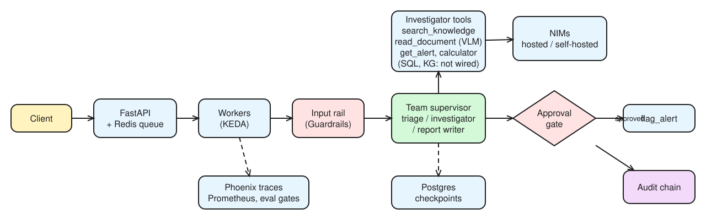
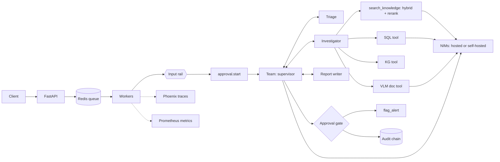

# Day 30 (W05 D04): the investigation team on one page

*Editable source: [w05d04-m7-architecture.excalidraw](img/w05d04-m7-architecture.excalidraw)*

Fixes vs the guide's draft: the input rail sits in front of a case (today it's a separate `input_rail.py` check, see gap 3); the approval gate writes to the audit chain. **SQL and KG tools exist (Day 27) but aren't registered in `graph.py`'s `TOOLS` yet**: the investigator today has `get_alert`, `search_policy`, `calculator`, `read_document`, `search_knowledge`.

| Layer | What we built | Days |
|---|---|---|
| **Agents** | Supervisor + triage, investigator, report writer (supervisor pattern); termination guards `MAX_TURNS` and `NO_PROGRESS`; must-hold routing rules belong in code, not the prompt | 18 |
| **State & memory** | LangGraph state; checkpoints keyed by case id (SQLite locally, `AsyncPostgresSaver` in the service); long-term memory in Supabase Postgres + pgvector with time-weighted recall; summary + buffer chat memory | 11–12, 28 |
| **Tools & protocols** | Registry with JSON schemas and idempotency keys (`flag_alert`); MCP server; A2A agent card; NAT `langgraph_wrapper`, `nat serve`, `nat mcp serve` | 4–6, 9, 29 |
| **Knowledge** | Hybrid dense + BM25 with RRF → reranking NIM over Milvus; ETL with clean → redact → chunk → content-hash dedup; read-only text-to-SQL; NetworkX evidence graph; VLM document reader | 13, 26–27, 29 |
| **Failure handling** | Retries with backoff, circuit breaker, fallback model, dead letters, escalation to a human; turn caps; queue + checkpoints so a crashed worker resumes | 9, 18, 28 |
| **Safety** | Role-based tool authz, sandbox, hash-chained audit; NeMo Guardrails (input/dialog/output rails, Safety Guard); input rail on alerts; retrieval-rail regex in `search_knowledge`; approval gate with named reviewer; kill switch; name-swap bias test | 7, 21–22, 29–30 |
| **Operations** | Phoenix tracing; Prometheus metrics, Grafana, SLO alerts; eval gates (Day 8 single agent, `eval_team.py` team); feedback API → flywheel → golden-set candidates; canary releases | 8, 15, 19–20, 30 |
| **Serving & deployment** | Hosted NIMs; self-hosted NIM (pinned profile, cache volume, AIPerf); FastAPI + Redis queue + workers; Kubernetes manifests with probes, CPU HPA for the API, KEDA on queue depth for workers, GPU NIM pod; GPU Operator / NIM Operator on a real cluster | 25, 28, 30 |

## Three known gaps

1. **Superseded-policy filter isn't in the hybrid path:** Day 13's `current_only` filter lives in `baseline.retrieve()`, but `search_knowledge` uses `rag_pipeline.retrieve(..., "best")` (hybrid + rerank) with no status filter, so v1 of the escalation policy can still be cited. Fix: carry `status` into the hybrid candidates and drop `superseded` before reranking.
2. **The judge can be the generator:** if `ragas_eval.py` judges with the same Nemotron model that wrote the answers, scores carry self-preference bias. Fix: a different judge model (or two judges and report agreement), and 3 judge runs on a sample to measure judge noise.
3. **The input rail isn't inside `approval.start()`:** `input_rail.check()` is a separate script, so a case can still start from an injected alert if a caller skips it. Fix: call `check()` at the top of `approval.start()` (and in the service's worker), and record blocks in the audit chain.
